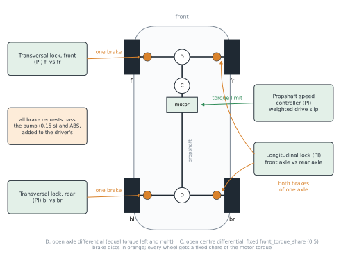
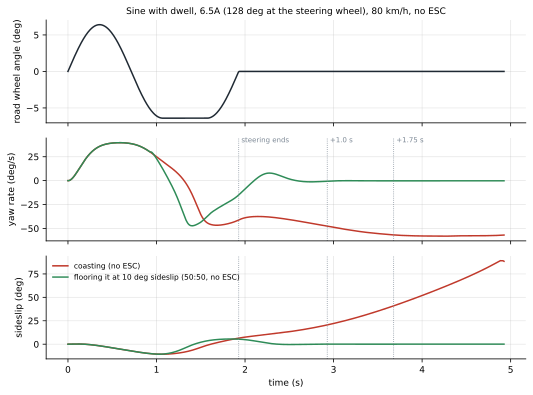
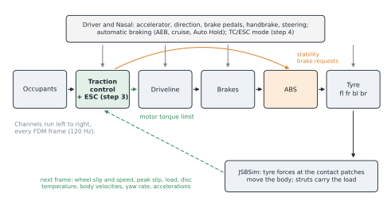
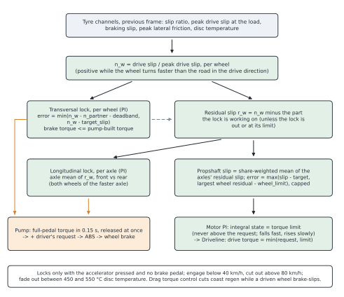
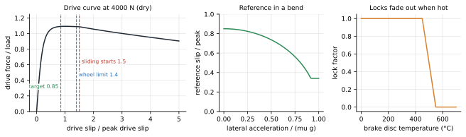
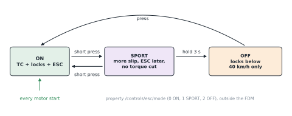
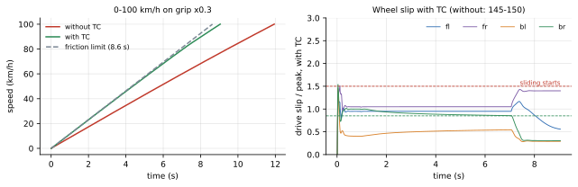
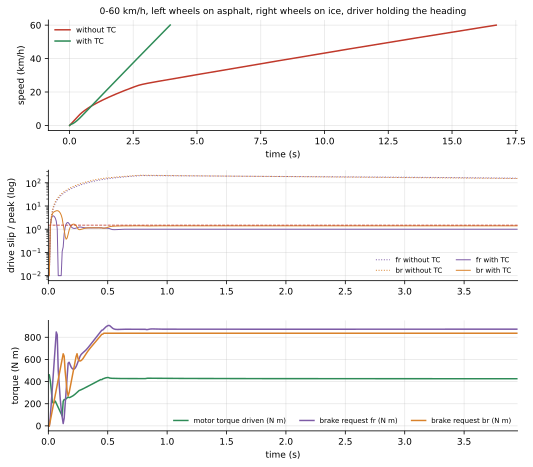
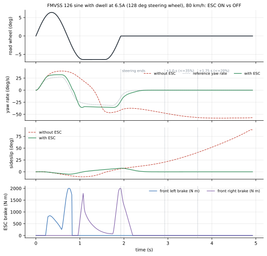

# 轮胎与传动模型牵引力及车身稳定性控制系统：工程技术手册

本手册规定了 Follow Me EV 轮胎与传动动力学模型（`followme_e-tron-tyre`）中牵引力控制系统（TCS）、电机拖曳扭矩控制系统（EDTC / MSR）与电子车身稳定性控制系统（ESC / ESP）的总体架构、控制律数学模型、标定参数体系及验证结果。本手册与 `dev/tyre-model/README.md` 配套使用，后者记录了底层轮胎刷子/魔术公式拟合模型、车轮角速度隐式积分器、液压制动系统及四通道防抱死制动系统（ABS）的物理实现。

本手册中的全部控制方程均与代码生成器 `dev/tyre-model/generate.py` 及生成的 JSBSim 系统文件 `Systems/tyre-model.xml` 一一对应。所有架构图与独立 JSBSim 时域仿真曲线由 `dev/tyre-model/manual_figures.py` 自动绘制，中英文 PDF 手册由 `dev/tyre-model/manual_pdf.py` 调用无头 Chrome 渲染生成。

---

## 1. 系统范围与边界

车辆动力学控制套件由四个功能子系统组成：

1. **牵引力控制系统（TCS）**：通过高速传动轴转速（电机扭矩）控制器与三个基于摩擦制动的电子差速锁控制器（一个轴间纵向差速锁、前/后轴各一个轴内横向差速锁，即电子差速锁 EDL）解耦协同，在加速工况下将各驱动轮的纵向滑移率维持在最佳附着区间附近，并跨越开放差速器向高附着车轮转移驱动力矩。
2. **电机拖曳扭矩控制（EDTC，亦称 MSR）**：抑制滑行能量回收力矩在低附着路面上引发过大的制动滑移，保证弯道松油门工况下驱动轮仍保有充足的侧向抓地力。
3. **电子车身稳定性控制（ESC / ESP）**：基于线性二自由度单轨参考模型实时比对车辆实际横摆角速度与质心侧偏角，通过对特定车轮主动施加非对称液压制动力矩、对助长失稳偏航的内侧车轮主动卸除驾驶员制动压力，以及平滑削减电机驱动扭矩，纠正转向不足与转向过度。
4. **驾驶员交互与状态指示（第 4 步）**：提供三态工作模式切换（`ON`、`SPORT`、`OFF`）、仪表盘故障/工作指示灯（`esc_sign`、`escoff_sign`）以及主动建压期间的液压泵工作音效。

所有闭环力与力矩解算均在 JSBSim 内部以完整飞行动力学帧率（标称 120 Hz，并在 60 Hz 至 240 Hz 范围内完成步长无关性验证）同步执行；Nasal 脚本仅负责座舱按键状态机、仪表指示灯动画及音效触发。标准简化 FDM（`followme_e-tron`）无独立车轮旋转自由度，不包含上述系统。

---

## 2. 参考文献与标准依据

| 编号 | 文献 / 标准来源 | 在本系统中的工程用途 |
|---|---|---|
| **S1** | K. Reif 主编，《*Brakes, Brake Control and Driver Assistance Systems*》，Bosch Professional Automotive Information 系列，Springer Vieweg，2014，ISBN 978-3-658-03978-3（“Traction control system”与“Electronic stability program”章节）。 | 单动力源+三开放差速器四驱车的 TCS 四控制器解耦架构（图 7、图 8）；控制器类型（传动轴类 PID 控制、差速锁带非线性死区 PI 控制）；参考滑移率修正规律；EDTC/MSR 原理；ESP 位于 TCS/ABS 之上的分层架构及线性单轨参考横摆角速度模型。 |
| **S2** | Audi 售后服务培训教材，自学计划 994475AG，《*Audi ESC systems*》。 | EDL（制动差速锁）与 TCS（降扭控制）的先后分工；制动盘温热衰退保护模型；MSR 逻辑；过度转向制动时的内侧轮减压策略；三模式按键逻辑与指示灯规范。 |
| **S3** | Volkswagen 自学计划 374，《*Traction Control and Assist Systems*》。 | EDL 工作车速区间；驾驶员踩下制动踏板时立即切除 EDL；制动盘超温保护；80 km/h 以上仅由发动机/电机扭矩执行 TCS。 |
| **S4** | 亚琛工业大学汽车工程研究所（ika）受 CITA 委托编写，报告 8329，《*A test procedure for vehicle dynamic controllers*》。 | 基于 55 km/h 干/湿地双移线实车试验辨识的 Mercedes-Benz A-Class 与 BMW 330xi（四驱）控制器模型与实测参数：过弯参考滑移下调比例、ESC 横摆角速度误差阈值、制动力矩量级、液压建压时间及带循环衰减的质心侧偏角限制策略。 |
| **S5** | BMW 技术培训教材，《*E46 Traction and Stability Control Systems*》。 | 主动制动介入时的回流泵建压机制；每次上电默认开启 DSC；短按/长按模式切换；SPORT 模式下 68 km/h（42 mph）以下放宽目标滑移率。 |
| **S6** | Audi A4 (B5) 维修手册，《*ABS/ESP System Description ("EDL" and "TCS")*》。 | 四驱车型 EDL 介入车速上限（40 km/h）与退出车速上限（80 km/h）；带上下阈值迟滞的制动盘温度估算模型。 |
| **S7** | Audi 技术新闻稿，《*In search of driving pleasure: quattro drive and suspension of the Audi e-tron*》，2021 年 9 月 15 日。 | 纯电四驱功率电子毫秒级滑移控制；约 150 ms 达到最大液压制动力；OFF 模式下保留低速起步滑移锁止控制。 |
| **S8** | 美国国家公路交通安全管理局（NHTSA）FMVSS No. 126（49 CFR 571.126）《*Electronic Stability Control Systems*》最终法规，2007（与联合国 UN ECE R140 法规等效）。 | 慢速递增转向（SIS）特征标定试验；80 km/h 正弦停顿（Sine with Dwell）横摆衰减与侧向位移合规判据；最低激活车速（20 km/h）；点火复位与仪表指示灯法规要求。 |
| **S9** | NHTSA 报告 DOT HS 809 747（存档于 `Docs/ABS/`）。 | 作为 TC 与 ESC 底层执行保障的四通道 ABS 滑移率控制及对开路面偏航力矩延迟（GMA）特性。 |

*版权与仓库管理说明*：文献 S1–S7 受版权保护，仅保存在本地 `Docs/ESC/` 目录并通过 `.gitignore` 排除在版本库之外，在文档中按书名与 ISBN 引用；S8 与 S9 为美国政府公开出版物。由于各国法规未对 TCS 加速性能设限且车企未公开冰雪加速对比试验曲线，TCS 依据物理摩擦极限及 S1–S7 描述的控制行为准则进行验证；ESC 则严格依据 FMVSS No. 126（S8）法规试验序列进行合规性验证。

---

## 3. 受控车辆对象与无控制基线动力学特性

### 3.1 传动系与制动执行机构

受控车辆由一台单电机驱动（峰值扭矩 $T_{m,\max} = 460\text{ N}\cdot\text{m}$，峰值功率 $P_{m,\max} = 375\text{ kW}$），经固定单级减速齿轮（传动比 $G = 9.73$）输入至固定扭矩分配比的中央开放差速器（前轴扭矩占比 $s = \text{front\_torque\_share} = 0.50$），再经前、后轴开放差速器驱动四个车轮。该机械拓扑与 Bosch 专著 S1 图 7、图 8 所分析的四驱车传动构型完全一致。



*图 1. 单电机+三开放差速器四驱传动系俯视图及第 6 节所述的四个解耦牵引力控制器作用位置。*

根据开放差速器的运动学与静力学关系，电机转子角速度 $\omega_m$ 为四轮角速度 $\omega_w$（$w \in \{fl, fr, bl, br\}$）按扭矩分配比加权的平均值：

$$\omega_m = G \left[ s \frac{\omega_{fl} + \omega_{fr}}{2} + (1 - s) \frac{\omega_{bl} + \omega_{br}}{2} \right]$$

各半轴获得的电机驱动力矩份额固定为：

$$T_{\text{drive},fl} = T_{\text{drive},fr} = \frac{1}{2} s G T_m, \qquad T_{\text{drive},bl} = T_{\text{drive},br} = \frac{1}{2} (1 - s) G T_m$$

在 $s = 0.50$ 及电机满扭矩（$460\text{ N}\cdot\text{m}$）下，每个车轮最高可分得 $1119\text{ N}\cdot\text{m}$ 的半轴驱动力矩。液压行车制动系统在满踏板下的单轮最大制动力矩为前轮 $T_{\text{brake,front}} = 2300\text{ N}\cdot\text{m}$、后轮 $T_{\text{brake,rear}} = 836\text{ N}\cdot\text{m}$（按 $1.15\,g$ 减速度下前轮先于后轮达到附着极限进行匹配）。四轮行车制动均受 ABS 通道保护，常规制动时前轴独立控制并带对开路面偏航力矩建立延迟，后轴采用低选（Select-Low）控制。

### 3.2 质量参数与稳态操纵稳定性指标

| 物理参数 | 标定值 | 工程说明 |
|---|---|---|
| 含 60 kg 驾驶员整备质量 ($m$) | $1635\text{ kg}$（前轴载荷占比 $52\%$） | 由 `dev/tyre-model/mass.py` 按零部件三维位置累加计算；质心高度 $h_{\text{cg}} \approx 0.46\text{ m}$ |
| 轴距 ($L$) 与轮距 ($b$) | $L = 2.480\text{ m}$，前后轮距 $b = 1.320\text{ m}$ | 读取自 `followme_e-tron.xml` 起落架接地结构坐标 |
| 横摆转动惯量 ($I_{zz}$) | $1830\text{ kg}\cdot\text{m}^2$ | 动力学指数 $I_{zz} / (m l_f l_r) = 0.72$，介于 S4 实测 A-Class（$0.66$）与 BMW 330xi（$0.85$）之间 |
| 悬架垂向刚度与侧倾刚度分配 | 每角 $78.8\text{ kN/m}$，前后侧倾刚度比 $50:50$ | 未设防倾杆；KIT 轮胎在 $4\text{ kN}$ 以下侧偏刚度近似与垂向载荷成正比 |
| 不足转向梯度 ($K_{\text{us}}$) | $40\text{ km/h}$ 时 $0.11^\circ/g$，$80\text{ km/h}$ 时 $0.21^\circ/g$，$120\text{ km/h}$ 时 $0.30^\circ/g$ | 线性区（$a_y \le 4\text{ m/s}^2$）稳态圆周试验拟合；呈微弱不足转向、接近中性转向特性 |
| 特征车速 ($v_{\text{char}}$) | $40\text{ km/h}$ 时 $111\text{ m/s}$，**$80\text{ km/h}$ 时 $82\text{ m/s}$**，$120\text{ km/h}$ 时 $68\text{ m/s}$ | $v_{\text{char}} = \sqrt{L / K_{\text{us}}}$；ESC 参考模型采用 $80\text{ km/h}$ 标定值（$82\text{ m/s}$） |

### 3.3 无 TC / ESC 时的开环基线表现

表 1 给出了在独立 JSBSim（120 Hz，平地）中关闭 TC 与 ESC（`tc/par/enabled = 0`，`esc/par/enabled = 0`）时的车辆开环基线响应。表中的“归一化滑移”定义为车轮驱动滑移率与当前垂向载荷下轮胎峰值驱动滑移率之比。

| 测试工况 | 开环动力学表现（无 TC、无 ESC） |
|---|---|
| 干沥青路面（$\mu = 1.0$），$50:50$，全油门起步 | $0\text{--}100\text{ km/h}$ 用时 $3.64\text{ s}$；加速载荷后移使前轴减载，较轻的右前轮冲过附着峰值至 $6.7$ 倍峰值滑移（左前轮为 $0.65$ 倍）。 |
| 干沥青路面（$\mu = 1.0$），$30:70$ 后偏置，全油门起步 | $0\text{--}100\text{ km/h}$ 用时 $3.43\text{ s}$；前后扭矩比与动态轴荷匹配，无车轮越过附着峰值。 |
| 低附着路面（$\mu \times 0.3$），$50:50$，全油门起步 | $0\text{--}100\text{ km/h}$ 用时 $11.94\text{ s}$（路面理论摩擦极限为 $8.6\text{ s}$）；四轮全部飞转至峰值滑移的 $\sim 150$ 倍并顶死在电机 $3000\text{ rad/s}$ 转速上限，落入 $75\%$ 动摩擦衰减区。 |
| 低附着路面（$\mu \times 0.3$），$30:70$ 后偏置，全油门起步 | 后轮先突破附着极限丧失侧向力，车辆迅速甩尾打转（航向偏转 $> 120^\circ$）。 |
| 对开路面（左 $\mu = 1.0$，右 $\mu \times 0.3$），全油门起步 | $0\text{--}60\text{ km/h}$ 用时 $5.6\text{ s}$；右侧低附着车轮空转至 $140$ 倍峰值滑移。 |
| 对开冰面（左 $\mu = 1.0$，右 $\mu \times 0.1$），全油门起步 | $0\text{--}60\text{ km/h}$ 用时 $16.73\text{ s}$；右侧冰面轮空转超过 $200$ 倍峰值滑移，将电机拉入 $3000\text{ rad/s}$ 断油限速区，导致左侧高附着车轮被同步切断驱动力矩。 |
| FMVSS 126 正弦停顿试验（$80\text{ km/h}$ 滑行，$A = 19.7^\circ$） | 左右双向从 $1.5A$ 至 $270^\circ$ 共 52 次试验中，**38 次横摆角速度衰减不合格，其中 13 次直接失控打转**（质心侧偏角达 $89^\circ$）。 |
| $6.5A$（方向盘转角 $128^\circ$）正弦停顿，侧偏角达 $10^\circ$ 时踩死全油门 | $50:50$ 四驱与前驱模式下，前轮纵向牵引力可将车头拉直救回（最大侧偏角 $11^\circ\text{--}18^\circ$）；$30:70$ 与后驱模式则加剧甩尾。 |



*图 2. 无 ESC 时 $80\text{ km/h}$、$6.5A$（方向盘幅值 $128^\circ$）正弦停顿试验的开环响应。松油门滑行时（红线），方向盘回正后横摆角速度无法收敛，车辆彻底掉头（侧偏角接近 $90^\circ$）；而在侧偏角达到 $10^\circ$ 时踩下全油门（绿线），$50:50$ 四驱的前轴牵引力可将车身姿态拉回。*

---

## 4. 控制系统架构与信号接口

### 4.1 单帧通道执行顺序

在每个 JSBSim 积分步（标称 $\Delta t = 1/120\text{ s} \approx 8.33\text{ ms}$）内，各子系统通道按以下拓扑从左至右依次求值：

```
Occupants -> Traction and stability control -> Driveline -> Brakes -> ABS -> Tyre fl, fr, bl, br
```



*图 3. 单个 FDM 仿真帧内的通道执行顺序与信号流向。`Traction and stability control` 通道读取上一帧轮胎与车体状态（1 帧延迟，120 Hz 下为 8.3 ms），计算当前帧的电机扭矩上限、制动减压系数及四轮稳定性制动请求。*

### 4.2 分层递阶控制结构（Bosch S1 架构）

系统严格遵循 Bosch（S1）定义的车辆动力学分层原则：

- **上层轨迹与姿态监督层（ESC）**：对比整车横摆角速度 $r$、质心侧偏角 $\beta$ 与驾驶员转向输入 $\delta$，通过电机扭矩折减系数（`esc/torque_factor`）、单轮附加液压制动请求（`esc/brake_<w>`）以及内侧车轮驾驶员制动压力保持系数（`esc/keep_<w>`）向下层下达指令。
- **中层牵引与拖曳滑移控制层（TCS & EDTC）**：由传动轴转速控制器输出电机驱动扭矩上限（`tc/motor_cap_nm`），由轴内横向锁与轴间纵向锁输出差速锁制动力矩（`tyre/<w>/tc_lock_nm`、`tc/lock_front_nm`、`tc/lock_rear_nm`），并由 EDTC 输出滑行回收折减系数（`tc/drag_factor`）。
- **底层车轮防抱死保护层（ABS）**：所有液压制动力矩请求——无论是驾驶员脚踏板、AEB/巡航自动制动、Auto Hold、TC 差速锁还是 ESC 纠偏制动——均在 `ABS` 通道入口汇合后再作用于车轮。因此，**任何上层控制器均不可能将车轮抱死**；一旦 ESC 或 TC 请求的制动力矩超出当前路面附着极限，ABS 会自动接管并将该轮维持在峰值制动滑移率附近。

### 4.3 执行器接口定义

1. **电机驱动扭矩限制（`tc/motor_cap_nm` 与 `esc/torque_factor`）**：
   在 `Driveline` 通道中，驾驶员踏板请求扭矩 `driveline/request_torque_nm` 先经 `tc/motor_cap_nm` 限幅，再乘以 `esc/torque_factor`，得到实际施加于传动系的电机驱动扭矩 `driveline/drive_torque_nm`：
   $$T_{\text{drive}} = T_{\text{req}} \cdot \min\!\left(1,\; \frac{T_{\text{cap,TC}}}{\max(|T_{\text{req}}|, 0.001)}\right) \cdot f_{\text{ESC}}$$
   鉴于电机逆变器具备毫秒级扭矩响应能力（S7），扭矩限制在当帧立即生效。`Nasal/engine.nas` 读取 `drive_torque_nm` 计算电池功率消耗。
2. **滑行能量回收调节（`tc/drag_factor`）**：
   当 EDTC 检测到松油门滑行引发过大负滑移时，按比例削减 `driveline/coast_torque_nm`：
   $$T_m = \text{motor\_on} \cdot \left[ T_{\text{drive}} + T_{\text{coast}} \cdot f_{\text{drag}} \cdot (1 - \text{abs\_any}) \right]$$
3. **稳定性主动制动叠加（`tyre/<w>/stab_brake_nm`）**：
   汇总各轮横向差速锁、纵向差速锁与 ESC 的制动力矩请求，经液压回流泵建压速率限幅（`tc/par/pump_time_s = 0.15 s` 建满全踏板力矩）后，在 ABS 之前与驾驶员制动请求相加。
4. **驾驶员制动压力主动卸除（`esc/keep_<w>`）**：
   在叠加 `stab_brake_nm` 之前，对驾驶员施加在该轮上的行车制动请求进行比例缩放：
   $$T_{\text{req,ABS},w} = \min\!\left(T_{\text{brake,max},w},\; u_{\text{service,axle}} T_{\text{brake,max},w} \cdot k_{\text{ESC},w} + T_{\text{stab},w}\right)$$

### 4.4 传感器与状态量输入

| 物理量 | 量产实车获取方式（S1, S2） | 本模型实现方式 |
|---|---|---|
| 车轮旋转角速度 $\omega_w$ | 轮速齿圈传感器 / 电机旋变传感器 | 精确状态量 `tyre/<w>/omega_rad_sec` |
| 接地点纵向对地速度 $v_{x,w}$ | 由非驱动轮轮速与纵向加速度计融合估计 | 精确运动学投影 `tyre/<w>/vx_wheel_mps` |
| 横摆角速度 $r$ 与侧向加速度 $a_y$ | 惯性测量单元（MEMS 陀螺仪与加速度计） | 车体坐标系精确值 `velocities/r-rad_sec` 与 `accelerations/Ny` |
| 前轮转向角 $\delta$ | 转向柱转角传感器除以转向传动比 | `fcs/steer-pos-deg[0]`（方向盘满偏 $900^\circ$ 对应前轮 $45^\circ$） |
| 车辆质心侧偏角 $\beta$ | 状态观测器估计 | 精确运动学值 $\arctan(v / \max(|u|, 0.3\text{ m/s}))$ |
| 路面峰值附着系数 $\mu_{\text{lat}}$ | 由纵向与侧向加速度包络在线估计 | 轮胎通道经垂向载荷与道面系数缩放后的真实峰值 `tyre/<w>/mu_y` |

---

## 5. 归一化状态变量与反馈信号

由于 KIT 205/55 R17 实测轮胎的峰值纵向滑移率随垂向载荷显著变化（在 $F_z = 1250, 4000, 6000\text{ N}$ 下，峰值驱动滑移率分别为 $\kappa_{\text{peak,drive}} = 18.0\%, 14.5\%, 8.5\%$，峰值制动滑移率分别为 $\kappa_{\text{peak,brake}} = 20.5\%, 14.0\%, 10.5\%$），所有滑移控制器均在**载荷归一化滑移坐标系**下工作——在该坐标系中，$1.0$ 恒对应当前垂向载荷下的轮胎最大纵力峰值点：

1. **单轮归一化驱动滑移率（`tyre/<w>/tc_slip`）**：
   $$n_w = \frac{\kappa_w \cdot d}{\kappa_{\text{peak,drive}}(F_{z,w})}$$
   其中 $\kappa_w = (\omega_w R - v_{x,w}) / \max(|v_{x,w}|, v_{\text{low}})$ 为纵向滑移率，$d \in \{+1, -1\}$ 为档位驱动方向（`driveline/in/direction`）。无论前进、倒车还是坡道溜车，只要车轮沿所选驱动方向的线速度大于地面速度，即有 $n_w > 0$。
2. **单轮归一化制动滑移率（`tyre/<w>/tc_brake_slip`）**：
   $$b_w = \frac{\max(0,\; -\kappa_w \operatorname{sgn}(v_{x,w}))}{\kappa_{\text{peak,brake}}(F_{z,w})}$$
3. **实测传动轴归一化滑移率（`tc/raw_slip`）**：
   四轮实测归一化驱动滑移率按前后轴扭矩分配比的加权均值，对应中央差速器输入轴（电机轴）的归一化超速量：
   $$n_{\text{raw}} = s \frac{n_{fl} + n_{fr}}{2} + (1 - s) \frac{n_{bl} + n_{br}}{2}$$
4. **有效侧向附着系数与侧向附着占用度（`tc/mu_lateral`、`tc/lateral_use`）**：
   $$\mu_{\text{lat}} = \frac{1}{4}\sum_{w} \mu_{y,w}, \qquad u_y = \min\!\left(1.0,\; \frac{|N_y|}{\max(\mu_{\text{lat}}, 0.05)}\right)$$
   式中 $N_y = a_y / g$ 为以 $g$ 为单位的侧向过载。

---

## 6. 牵引力控制系统（TCS）与拖曳扭矩控制（EDTC）

遵循 Bosch（S1）的四驱解耦控制原则，系统由三个基于制动的差速锁控制器消除车轮间与轴间的**滑移差**，并由一个传动轴转速控制器通过电机扭矩调节所有驱动轮共同承担的**共模滑移**。



*图 4. 四控制器牵引力控制系统信号流图。横向与纵向制动差速锁优先吸收同轴左右轮及前后轴之间的滑移差异；仅将锁止后剩余的残余滑移 $r_w$（以及当制动器达到物理力矩上限时的软饱和溢出量）送入电机控制器。*

### 6.1 横向差速锁控制器（轴内电子差速锁 EDL）

前、后轴各设一个带迟滞特性的 PI 控制器，比较同轴左右车轮的归一化驱动滑移率 $n_w$ 与 $n_{\text{partner}}$（`fl` 对 `fr`，`bl` 对 `br`）：

1. **宽进严出迟滞误差律（Hysteresis）**：
   为避免在均匀路面上因微小载荷差异（如左侧驾驶员体重）引发频繁拖刹或让打滑轮长期滞留在峰值外侧，控制器对左右轮滑移差采用双阈值迟滞死区：
   $$d_w = \begin{cases} d_{\text{rel}} = 0.10 & \text{若 } T_{\text{lock,state},w} > 0\text{（已激活）} \\ d_{\text{eng}} = 0.50 & \text{若 } T_{\text{lock,state},w} = 0\text{（未激活）} \end{cases}$$
   $$e_{\text{lock},w} = \min\!\left(n_w - n_{\text{lock,target}},\; n_w - n_{\text{partner}} - d_w\right)$$
   其中激活后的锁止目标滑移率为 $n_{\text{lock,target}} = 1.0$。当锁处于静默状态时，打滑轮必须同时越过自身附着峰值（$n_w > 1.0$）且比同轴另一轮多滑 $0.50$ 以上才会触发锁止；一旦触发（$T_{\text{lock,state},w} > 0$），控制器将打滑轮直接拉回其峰值附着点 $n_{\text{lock,target}} = 1.0$ 附近，直至左右滑移差缩小至 $d_{\text{rel}} = 0.10$ 以下才释放。
2. **车速、踏板与盘温门控条件**：
   依据 S3 与 S6，差速锁仅在踩下加速踏板（`throttle_norm > 0.01`）、松开行车制动踏板（`< 0.02`）、该轴有驱动力分配且车速低于介入上限 $v_{\text{eng}} = 40\text{ km/h}$（已处于锁止状态时可维持至退出上限 $v_{\text{cut}} = 80\text{ km/h}$）时允许工作。
3. **与液压泵同步的抗积分饱和及请求扭矩上限**：
   在驾驶员当前加速踏板开度下，开放差速器能向车轮 $w$ 传递的最大半轴驱动力矩为：
   $$T_{\text{req},w} = \frac{1}{2} s_{\text{axle}} G |T_{\text{req}}|$$
   锁的积分状态量 $T_{\text{lock,state},w}$ 受液压泵下一帧最大可建压力约束（防止建压期间积分器抢跑饱和），且锁的输出力矩 $T_{\text{lock},w}$ 同时受该轮满踏板最大制动力矩 $T_{\text{brake,max},w}$ 与驾驶员请求半轴扭矩 $T_{\text{req},w}$ 双重封顶：
   $$T_{\text{lock,state},w}[k] = \text{on}_w \cdot \max\!\left(0,\; \min\!\left(T_{\text{brake,max},w},\; T_{\text{stab},w}[k-1] + \frac{\Delta t}{\tau_{\text{pump}}} T_{\text{brake,max},w},\; T_{\text{lock,state},w}[k-1] + \Delta t \, K_{I,\text{lock}} e_{\text{lock},w} T_{w,\max}\right)\right)$$
   $$T_{\text{lock},w}[k] = \text{on}_w \cdot f_{\text{temp},w} \cdot \max\!\left(0,\; \min\!\left(T_{\text{brake,max},w},\; T_{\text{req},w},\; T_{\text{lock,state},w}[k] + K_{P,\text{lock}} e_{\text{lock},w} T_{w,\max}\right)\right)$$
   式中 $T_{w,\max} = \frac{1}{2} s_{\text{axle}} G T_{m,\max}$，$K_{P,\text{lock}} = 0.2$，$K_{I,\text{lock}} = 8.0\text{ s}^{-1}$。将锁输出上限绑定在 **TC 降扭前**的驾驶员请求半轴扭矩 $T_{\text{req},w}$（满油门为 $1119\text{ N}\cdot\text{m}$），既杜绝了前轮制动锁超调至 $1900\text{ N}\cdot\text{m}$ 把冰面轮反拖抱死，又保证了电机控制器短时收油时差速锁不会跟着泄压。
4. **残余滑移与软饱和移交（`tyre/<w>/tc_resid`）**：
   当横向锁未达到该轮制动器物理上限（$T_{\text{lock},w} \le 0.98\,T_{\text{brake,max},w}$）时，从 $n_w$ 中扣除锁正在处理的误差项 $e_{\text{lock},w}$；当制动器达到物理上限（如后轮满踏板力矩仅 $836\text{ N}\cdot\text{m} < 1119\text{ N}\cdot\text{m}$）时，采用**软饱和移交**，向电机控制器移交不超过单轮上限 $n_{\text{wheel\_limit}} = 1.4$ 以上 $0.5$ 的滑移量，避免饱和瞬间将十几倍的原始空转滑移一次性砸给电机导致动力断崖下跌：
   $$r_w = \begin{cases} \min(n_w,\; n_{\text{wheel\_limit}} + 0.5) & \text{若 } \text{on}_w = 1 \text{ 且 } T_{\text{lock},w} > 0.98\,T_{\text{brake,max},w} \\ n_w - \text{on}_w f_{\text{temp},w} \max(0, e_{\text{lock},w}) & \text{其他情况} \end{cases}$$

### 6.2 纵向差速锁控制器（轴间电子差速锁）

在四驱模式下（$0 < s < 1$），纵向差速锁采用完全相同的带迟滞 PI 控制器，比较前、后轴的平均残余滑移：

$$n_{\text{axle,front}} = \frac{r_{fl} + r_{fr}}{2}, \qquad n_{\text{axle,rear}} = \frac{r_{bl} + r_{br}}{2}$$

当某一轴的平均残余滑移超出另一轴达 $0.50$ 以上时，对该打滑轴的左右两轮对称施加制动力矩 $T_{\text{lock,axle}}$（模拟中央差速锁），并将吸收掉的轴间滑移差从轴滑移中扣除，输出各轴送往传动轴控制器的残余滑移 $n_{\text{prop,front}}$ 与 $n_{\text{prop,rear}}$。

### 6.3 传动轴转速控制器（电机扭矩类 PID 控制器）

电机控制器调节按扭矩分配比加权的总残余滑移：

$$n_{\text{prop}} = s \, n_{\text{prop,front}} + (1 - s) \, n_{\text{prop,rear}}$$



*图 5. 左：$4000\text{ N}$ 垂向载荷下的干地纵向驱动力拟合曲线及电机目标滑移（$0.85$）、单轮残余上限（$1.40$）与滑动摩擦起始点（$1.50$）。中：过弯时参考滑移率 $n_{\text{ref}}$ 随侧向附着占用度 $u_y$ 的椭圆衰减曲线。右：差速锁热衰退系数 $f_{\text{temp}}$ 随制动盘温度的变化曲线。*

1. **过弯参考滑移率（`tc/target`）**：
   依据摩擦椭圆关系（对应 S1 的理论要求及 S4 过弯阈值下调约三分之一的实测规律），目标驱动滑移率随侧向加速度对附着圆的占用度自动下调：
   $$n_{\text{ref}} = n_{\text{target}} \cdot \max\!\left(c_{\min},\; \sqrt{\max(0,\; 1 - u_y^2)}\right)$$
   其中直行目标滑移率 $n_{\text{target}} = 0.85$，满侧向占用时的保底系数 $c_{\min} = 0.40$。
2. **对实测传动轴滑移率求导的步长无关滤波微分项（`tc/slip_rate`）**：
   为在车轮冲过附着峰值前提前压制低附着起步初段的滑移尖峰，并在制动锁刹住空转轮开始减速（$\dot{n} < 0$）时立即提供负反馈相位超前以防止电机过度降扭，控制器对实测传动轴滑移率 $n_{\text{raw}}$ 施加时间常数为 $\tau_d = 0.025\text{ s}$ 的一阶低通滤波求导：
   $$\dot{n}_{\text{filt}}[k] = \dot{n}_{\text{filt}}[k-1] + \frac{\Delta t}{\tau_d + \Delta t}\left(\frac{n_{\text{raw}}[k] - n_{\text{raw}}[k-1]}{\Delta t} - \dot{n}_{\text{filt}}[k-1]\right) = \frac{n_{\text{raw}}[k] - n_{\text{raw}}[k-1] + \tau_d \dot{n}_{\text{filt}}[k-1]}{\tau_d + \Delta t}$$
   该式分子与分母中的积分步长 $\Delta t$ 解析约去，消除了除以小步长 $\Delta t$ 带来的高频噪声放大，使 60 Hz、120 Hz 与 240 Hz 下的微分响应完全一致。
3. **带单轮保护的合成滑移误差（`tc/error`）**：
   当车速超过 $80\text{ km/h}$ 差速锁退出后，若单侧车轮压上低附着路面，四轮平均滑移可能仍低于 $n_{\text{ref}}$。为此引入单轮残余滑移上限 $n_{\text{wheel\_limit}} = 1.40$（略低于 $1.50$ 的滑动摩擦起始点）监控最快残余滑移轮 $n_{\text{wheel\_max}} = \max_w r_w$：
   $$e_m = \min\!\left(e_{\max},\; \max\!\left(n_{\text{prop}} + t_d \dot{n}_{\text{filt}} - n_{\text{ref}},\; n_{\text{wheel\_max}} - n_{\text{wheel\_limit}}\right)\right)$$
   其中微分超前时间 $t_d = 0.025\text{ s}$，最大误差限幅 $e_{\max} = 2.0$。
4. **以扭矩上限本身作为积分状态的控制律（`tc/cap_nm` 与 `tc/motor_cap_nm`）**：
   控制器的积分状态量直接定义为电机扭矩上限 $T_{\text{cap}}$，其初值与上界均实时钳位在驾驶员请求扭矩 $|T_{\text{req}}|$ 以内，从根本上杜绝积分饱和：
   $$T_{\text{cap}}[k] = \max\!\left(0,\; \min\!\left(T_{m,\max},\; \min(T_{\text{cap}}[k-1], |T_{\text{req}}|) - \Delta t \, T_{m,\max} \, e_m \, R(e_m)\right)\right)$$
   $$T_{\text{cap,TC}}[k] = \max\!\left(0,\; T_{\text{cap}}[k] - K_{P,m} e_m T_{m,\max}\right)$$
   当 $e_m > 0$（滑移超标）时采用快降速率 $R(e_m) = K_{\text{cut}} = 10.0\text{ s}^{-1}$，当 $e_m \le 0$（滑移恢复）时采用慢升速率 $R(e_m) = K_{\text{restore}} = 5.0\text{ s}^{-1}$，比例增益 $K_{P,m} = 0.30$。

### 6.4 液压制动合成路径、泵建压动态与 ABS 越权解耦

单轮总稳定性制动目标力矩汇总了该轮的横向锁、所属轴的纵向锁以及 ESC 制动请求：

$$T_{\text{stab,target},w} = \min\!\left(T_{\text{brake,max},w},\; \min(T_{\text{req},w},\; T_{\text{lock},w} + T_{\text{lock,axle}}) + T_{\text{ESC},w}\right)$$

液压泵建压受最大上升速率 $T_{\text{brake,max},w} / \tau_{\text{pump}}$ 限制（$\tau_{\text{pump}} = 0.15\text{ s}$，与 S7 实车 150 ms 建压时间及 S4 的 $0.05\text{--}0.15\text{ s}$ 标定区间一致），泄压则即时响应：

$$T_{\text{stab},w}[k] = \min\!\left(T_{\text{stab,target},w}[k],\; T_{\text{stab},w}[k-1] + \frac{\Delta t}{\tau_{\text{pump}}} T_{\text{brake,max},w}\right)$$

当任一后轮存在主动稳定性制动请求（$T_{\text{stab},w} > 0$）时，`ABS` 通道自动解除后轴低选（Select-Low）约束而对该后轮实施独立防抱死调节；当前轮存在主动稳定性制动请求时，自动旁路前轴对开路面偏航力矩延迟。

### 6.5 制动盘温升热模型与差速锁热衰退保护

为复现量产车 EDL 的防过热保护特性（S2, S6），系统采用集中热容能量方程对四个制动盘的温度 $T_{d,w}$（$^\circ\text{C}$）分别积分（计入驾驶员制动与主动控制制动的全部摩擦热功率及随车速增强的对流散热）：

$$m_{d,w} c_d \frac{dT_{d,w}}{dt} = \left(T_{\text{service},w} + T_{\text{mech},w}\right) |\omega_w| - \left(h_0 + h_1 |v_{x,w}|\right)\left(T_{d,w} - T_{\text{amb}}\right)$$

其中灰铸铁比热容 $c_d = 460\text{ J/(kg}\cdot\text{K)}$，前、后制动盘质量分别为 $m_{d,\text{front}} = 9\text{ kg}$ 与 $m_{d,\text{rear}} = 7\text{ kg}$，静态散热系数 $h_0 = 20\text{ W/K}$，对流散热速度系数 $h_1 = 2.0\text{ W/(K}\cdot\text{m/s)}$，环境温度 $T_{\text{amb}} = 20\,^\circ\text{C}$。差速锁输出力矩乘以线性热衰退系数：

$$f_{\text{temp},w} = \operatorname{clip}\!\left(\frac{T_{\text{off}} - T_{d,w}}{T_{\text{off}} - T_{\text{fade}}},\; 0,\; 1\right), \qquad T_{\text{fade}} = 450\,^\circ\text{C},\quad T_{\text{off}} = 550\,^\circ\text{C}$$

### 6.6 电机拖曳扭矩控制（EDTC / MSR）

当驾驶员在极低附着路面上松开加速踏板时，滑行能量回收力矩绕过 ABS 直接作用在驱动轮上。一旦任一驱动轮的归一化制动滑移率 $b_{\max} = \max_w b_w$ 超过阈值 $b_{\text{drag}} = 0.35$，折减系数 $f_{\text{drag}} \in [0, 1]$ 以 $K_{\text{drag,cut}} = 20.0\text{ s}^{-1}$ 的速率快速下调，并在滑移回落至 $0.35$ 以下后以 $K_{\text{drag,restore}} = 2.0\text{ s}^{-1}$ 的速率缓慢恢复：

$$f_{\text{drag}}[k] = \operatorname{clip}\!\left(f_{\text{drag}}[k-1] + \Delta t \begin{cases} -K_{\text{drag,cut}} & \text{若 } b_{\max} > 0.35 \\ +K_{\text{drag,restore}} & \text{若 } b_{\max} \le 0.35 \end{cases},\; 0,\; 1\right)$$

将触发阈值设定在峰值制动滑移的 $35\%$（$b_{\text{drag}} = 0.35$），可确保在切除拖曳力矩时轮胎仍保留至少 $\sqrt{1 - 0.35^2} \approx 94\%$ 的侧向附着能力，防止冰面弯道松油门甩尾。

---

## 7. 电子车身稳定性控制（ESC）

ESC 在前进档且纵向车速高于 $v_{\min,\text{ESC}} = 20\text{ km/h}$ 时激活（S8）。系统采用基于本车稳态圆周试验标定的线性单轨参考模型（S1），结合经路面附着系数连续缩放的横摆与侧偏控制律（源自 S4 四驱车型阈值结构）。

### 7.1 线性单轨参考横摆角速度与相位匹配

由线性二自由度单轨（自行车）模型，在纵向车速 $v_x$ 与前轮转向角 $\delta$ 下，驾驶员期望的稳态横摆角速度为：

$$r_{\text{ss}} = \frac{v_x \, \delta}{L \left(1 + \left(v_x / v_{\text{char}}\right)^2\right)}$$

其中轴距 $L = 2.480\text{ m}$，$v_{\text{char}} = 82.0\text{ m/s}$ 为本车在 $80\text{ km/h}$ 下实测的特征车速。特征车速必须使用本车实测值：若直接套用 S4 中不足转向更强的 BMW 330xi 参数（$16.7\text{ m/s}$），在 $80\text{ km/h}$ 下的参考横摆角速度会被低估一半以上，导致日常 $0.3\,g$ 正常过弯被误判为严重过度转向。

受路面侧向附着极限 $\mu_{\text{lat}} g$ 约束，稳态横摆角速度幅值上限为：

$$r_{\text{lim}} = \frac{\mu_{\text{lat}} g}{\max(v_x, 1.0\text{ m/s})}$$

为对齐方向盘转角输入与车体实际横摆响应之间的瞬态相位滞后（S4 采用全通滤波器），系统维护两个时间常数为 $\tau_{\text{ref}} = 0.10\text{ s}$ 的一阶滞后参考状态：

1. **制动干预参考横摆角速度（`esc/ref`）**，严格按 $1.0\,r_{\text{lim}}$ 封顶：
   $$\dot{r}_{\text{ref}} = \frac{\operatorname{clip}(r_{\text{ss}}, -r_{\text{lim}}, +r_{\text{lim}}) - r_{\text{ref}}}{\tau_{\text{ref}}}$$
2. **不足转向降扭参考横摆角速度（`esc/ref_us`）**，放宽至 $1.5\,r_{\text{lim}}$ 封顶：
   $$\dot{r}_{\text{ref,us}} = \frac{\operatorname{clip}(r_{\text{ss}}, -1.5\,r_{\text{lim}}, +1.5\,r_{\text{lim}}) - r_{\text{ref,us}}}{\tau_{\text{ref}}}$$

*双参考设计机理*：在低附着弯道中，当驾驶员踩着油门把方向盘打过头（远超路面附着极限）时，若参考值严格卡死在 $1.0\,r_{\text{lim}}$，则 $r_{\text{ref}}$ 与实际 $r$ 之差几乎为零，系统无法识别驾驶员的大转角推头意图；将**降扭专用**的参考上限放宽至 $1.5\,r_{\text{lim}}$ 可使 ESC 及时识别带油门推头并削减电机动力，而将**内后轮制动**参考严格限制在 $1.0\,r_{\text{lim}}$ 则可避免正弦停顿极限反打时内后轮乱加制动诱发甩尾。

### 7.2 横摆角速度与质心侧偏角闭环控制律

定义转向方向符号 $\sigma = \operatorname{sgn}(r) \in \{+1, -1\}$，当 $|r| > r_{\text{bend}} = 0.05\text{ rad/s}$（$2.9^\circ/\text{s}$）时判定进入弯道（`bend = 1`），投影到转向方向上的过度转向误差与不足转向误差分别为：

$$e_{\text{os}} = \text{bend} \cdot (r - r_{\text{ref}})\sigma, \qquad e_{\text{us}} = \text{bend} \cdot (r_{\text{ref}} - r)\sigma, \qquad e_{\text{us,drive}} = \text{bend} \cdot (r_{\text{ref,us}} - r)\sigma$$

所有 ESC 主动制动力矩均乘以有效侧向附着系数 $g_\mu = \min(1.0, \mu_{\text{lat}})$，使冰雪路面上的纠偏制动力与路面抓地力成比例匹配，避免一介入就将车轮打入深度 ABS 振荡：

| 控制分支 | 触发区间 | 连续控制律与执行机构 | 文献依据 |
|---|---|---|---|
| **线性死区（不干预区）** | $\|r\| \le 0.05\text{ rad/s}$，或 $\max(e_{\text{os}}, e_{\text{us,drive}}) \le 0.07\text{ rad/s}$ 且 $\|\beta\| \le 10^\circ$ | 不做任何干预（$T_{\text{ESC},w} = 0$，$k_{\text{ESC},w} = 1$，$f_{\text{ESC}} = 1$）。确保 $8\text{ m/s}^2$ 以内的稳态过弯无任何电子干预感。 | S1, S4, S8 |
| **过度转向外前轮主动制动** | $e_{\text{os}} \in [0.07, 0.15]\text{ rad/s}$（$4.0^\circ/\text{s}\text{ 至 }8.6^\circ/\text{s}$） | 对**弯道外侧前轮**（右转刹 `fl`，左转刹 `fr`）从 $0$ 线性递增至 $g_\mu d_\beta \cdot 2000\text{ N}\cdot\text{m}$，产生逆偏航恢复力矩。 | S1, S4 |
| **过度转向内侧轮主动减压** | $e_{\text{os}} \in [0.07, 0.15]\text{ rad/s}$ 且驾驶员正在踩刹车 | 将**弯道内侧前、后轮**的驾驶员行车制动压力保持比例 $k_{\text{ESC}}$ 从 $100\%$ 线性下调至最低 $20\%$（最大卸压 $80\%$），消除对开路面急刹或弯中重刹时内侧高附着轮助长甩尾的偏航力矩。 | S2, S8 |
| **不足转向内后轮主动制动** | $e_{\text{us}} \in [0.07, 0.10]\text{ rad/s}$（$4.0^\circ/\text{s}\text{ 至 }5.7^\circ/\text{s}$） | 对**弯道内侧后轮**（右转刹 `br`，左转刹 `bl`）从 $0$ 线性递增至 $g_\mu d_\beta \cdot 600\text{ N}\cdot\text{m}$，帮助车头向弯心偏转。 | S1, S4 |
| **质心侧偏角限制与循环阻尼** | $\|\beta\| \in [10^\circ, 12^\circ]$ | 接管横摆制动控制，对**车身侧滑方向同侧的前轮**（$\beta < 0$ 刹 `fl`，$\beta > 0$ 刹 `fr`）施加 $300\,g_\mu$ 至 $600\,g_\mu\text{ N}\cdot\text{m}$ 的制动力矩。每次退出侧偏限制时将横摆制动衰减系数 $d_\beta$ 乘以 $0.60$（当方向盘回正至 $\|\delta\| < 1^\circ$ 且 $\|r\| < 0.05\text{ rad/s}$ 时复位为 $1.0$），抑制冰面连续反打时的钟摆振荡。 | S4 |
| **电机扭矩平滑折减** | $\max(e_{\text{os}}, e_{\text{us,drive}}) \in [0.07, 0.15]\text{ rad/s}$ | 随误差将电机扭矩折减系数 $f_{\text{ESC}}$ 从 $1.0$ 线性降至 $0.25$（即 TC 允许扭矩的 $1/4$）；误差消退后保持 $\tau_{\text{hold}} = 0.30\text{ s}$，随后在 $\tau_{\text{restore}} = 0.30\text{ s}$ 内平滑恢复至 $1.0$。 | S4（由 2 s 缩短为 0.3 s） |

---

## 8. 驾驶员控制开关、仪表指示灯与声学反馈（第 4 步规范）

驾驶模式属性存储在 FDM 外部的 `/controls/esc/mode`（`0` = `ON`，`1` = `SPORT`，`2` = `OFF`），从而在车辆重置位置（Reposition）时保持驾驶员所选模式，而在每次电机重新上电启动时按法规要求自动复位为 `0`（`ON`）（S2, S5, S8）。



*图 6. 三态驾驶模式切换状态机与座舱按键操作逻辑（第 4 步实现）。*

| 模式 (`/controls/esc/mode`) | 电机牵引力控制 (Motor TC) | 制动差速锁 (EDL) | 车身稳定性控制 (ESC) | 仪表盘指示灯状态 |
|---|---|---|---|---|
| **0: ON**（上电默认） | 开启（$n_{\text{target}} = 0.85$） | 开启（$< 40\text{ km/h}$ 介入，$< 80\text{ km/h}$ 维持） | 开启（$> 20\text{ km/h}$） | `escoff_sign` 熄灭；TC/ESC 工作时 `esc_sign` 闪烁 |
| **1: SPORT**（短按切换） | 开启；$68\text{ km/h}$ 以下目标滑移提高至 `sport_target`（S5） | 开启 | 开启但放宽侧偏角阈值；取消过度转向切动力以保留 $50:50$ 四驱油门救车特性（S2, S7） | `escoff_sign` 常亮；TC/ESC 工作时 `esc_sign` 闪烁 |
| **2: OFF**（长按 $\ge 3\text{ s}$） | 关闭 | 仅在 $40\text{ km/h}$ 以下保留低速起步防滑锁止（S7） | 关闭 | `escoff_sign` 常亮 |

当稳定性制动系统主动建压（$\dot{T}_{\text{stab},w} > 0$）时，车内视角同步触发液压泵工作音效（`Sounds/abs.wav`，在 `Sounds/followme-sound.xml` 中设定车内音量系数为 `0.35`）（S5）。

---

## 9. 仿真验证与动态性能指标

全部 68 项回归与合规测试均通过 `pytest dev/tyre-model/test_tyre_model.py` 在独立 JSBSim 中自动运行验证。

### 9.1 牵引力控制（TCS & EDTC）验证结果

| 测试场景 | 验收判据 | 120 Hz 实测结果（括号内为关闭 TC 的基线值） |
|---|---|---|
| 干地全油门起步（$50:50$，$\mu = 1.0$） | $0\text{--}100\text{ km/h}$ 不慢于无 TC；$0.5\text{ s}$ 后归一化滑移 $< 1.50$ | **$3.53\text{ s}$**（$3.64\text{ s}$）；最大归一化滑移 **$1.45$**（$6.71$） |
| 均匀低附着全油门起步（$50:50$，$\mu \times 0.3$） | 接近理论摩擦极限（$8.6\text{ s}$，误差 $< 15\%$）；$0.5\text{ s}$ 后滑移 $< 1.50$ | **$9.05\text{ s}$**（$11.94\text{ s}$）；初段尖峰由 $2.44$ 压至 **$1.54$**，$0.5\text{ s}$ 后最大 **$1.43$**（$150.5$）；右前轮稳态滑移 **$1.05$** |
| 对开冰面全油门起步（左 $\mu = 1.0$，右 $\mu \times 0.1$，驾驶员保持航向） | $0\text{--}60\text{ km/h}$ 用时 $< 40\%$ 无 TC 时间；仅冰面轮受制动；前轮锁力矩 $\le 1120\text{ N}\cdot\text{m}$；电机最低扭矩 $> 50\text{ N}\cdot\text{m}$ | **$3.95\text{ s}$**（$16.73\text{ s}$）；稳态滑移 **$1.40$**（$212.1$）；右前锁峰值力矩 **$907\text{ N}\cdot\text{m}$**，最小滑移 **$+0.003$**（无反拖负滑移）；航向偏差 **$2.2^\circ$** |
| 后偏置（$30:70$）与纯后驱在 $\mu \times 0.3$ 路面起步 | 不发生甩尾失控（航向偏差 $< 15^\circ$），顺利加速至 $60\text{ km/h}$ | $30:70$：**$5.30\text{ s}$**，航向偏差 **$2.5^\circ$**（无 TC 直接打转）；纯后驱：**$11.2\text{ s}$**，航向偏差 **$11^\circ$** |
| 纯后驱在 $40\text{ km/h}$ 弯道中全油门加速 | 最大质心侧偏角 $\|\beta\| < 10^\circ$ | **$4.6^\circ$**（无 TC 时 $> 45^\circ$ 打转） |
| 低附着路面（$\mu \times 0.3$）倒车全油门加速 | $0\text{--}20\text{ km/h}$ 快于无 TC，滑移 $< 1.50$ | **$1.76\text{ s}$**（$2.32\text{ s}$），滑移 $< 1.45$ |
| 日常平顺驾驶（干地 $30\%$ 油门直行、$60\text{ km/h}$ 稳态过弯） | TC 与差速锁零误触发 | 全程 `tc/active = 0` |
| 差速锁车速、制动踏板与盘温保护规则 | $> 40\text{ km/h}$ 不新介入；$> 80\text{ km/h}$ 退出；踩刹车立即释放；$600\,^\circ\text{C}$ 热衰退完全退出 | 四项门控规则全部验证通过 |
| EDTC 滑行防抱死（$\mu \times 0.1$ 冰面 $40\text{ km/h}$ 施加 $300\text{ N}\cdot\text{m}$ 强回收） | 驱动轮最大归一化制动滑移 $< 0.70$ | **$0.56$**（无 EDTC 时达 $7.40$ 抱死） |
| 仿真帧率无关性（$60\text{ Hz}$、$240\text{ Hz}$ 对比 $120\text{ Hz}$） | 各工况加速时间偏差 $< 8\%$ | 全工况跨帧率偏差 **$< 2.8\%$** |



*图 7. 均匀低附着路面（$\mu \times 0.3$）$0\text{--}100\text{ km/h}$ 全油门起步。左：开启 TC 后的车速曲线（$9.05\text{ s}$，绿线）紧贴路面理论摩擦极限（$8.6\text{ s}$，灰色虚线），显著快于无 TC 基线（$11.94\text{ s}$，红线）。右：四轮归一化驱动滑移率。滤波微分项将 $t = 0.05\text{ s}$ 初段尖峰抑制在 $1.54$；横向差速锁的迟滞机制将载荷最轻的右前轮（`fr`，紫线）拉回峰值附着点（$1.05$），与左前轮（`fl`，$0.95$）共同工作在峰值区间，直至 $80\text{ km/h}$（$t = 6.8\text{ s}$）差速锁退出后由单轮上限（$1.40$）接管。*



*图 8. 对开冰面（左轮干沥青 $\mu = 1.0$，右轮冰面 $\mu \times 0.1$，驾驶员保持航向）$0\text{--}60\text{ km/h}$ 全油门起步。上：加速时间由无 TC 的 $16.73\text{ s}$ 缩短至 $3.95\text{ s}$。中：右侧冰面轮（`fr`、`br`）归一化驱动滑移率对数曲线。下：电机实际输出驱动扭矩与右侧两轮差速锁制动请求。通过将差速锁上限约束在驾驶员请求半轴扭矩并引入实测滑移率滤波微分项，彻底消除了前轮制动超调（`fr` 最高 $907\text{ N}\cdot\text{m}$），并在后轮锁达到 $836\text{ N}\cdot\text{m}$ 满踏板上限后使电机扭矩平稳维持在 $\sim 340\text{ N}\cdot\text{m}$。*

### 9.2 电子车身稳定性控制（ESC）验证结果

| 测试场景 | 验收判据 | 120 Hz 实测结果（括号内为关闭 ESC 的基线值） |
|---|---|---|
| **FMVSS No. 126 正弦停顿试验**（$80\text{ km/h}$ 滑行，$A = 19.7^\circ$，双向 $1.5A$ 至 $270^\circ$ 共 52 次） | 转向结束后 $1.0\text{ s}$ 横摆角速度 $\le$ 峰值的 $35\%$，$1.75\text{ s}$ 后 $\le 20\%$；$\ge 5A$ 时 $1.07\text{ s}$ 侧向位移 $\ge 1.83\text{ m}$；无打转 | **52 次全部合格**（无 ESC 时 **38 次不合格、13 次打转**）；$1.0\text{ s}$ 后横摆残留 **$0\%$**（$136\%$）；$1.75\text{ s}$ 后 **$0\%$**（$159\%$）；最大侧偏角 **$8.6^\circ$**（$88.7^\circ$）；最小侧向位移 **$3.06\text{ m}$** |
| 线性区零干扰验证（$40, 80, 120\text{ km/h}$ 下 $\le 4\text{ m/s}^2$ 稳态圆周、$2A$ 正弦停顿、直线加速与急刹） | ESC 零误触发（`esc/active = 0`） | 全程不介入（稳态过弯直至 $8\text{ m/s}^2$ 均不误触发） |
| 干地严重转向不足（$90\text{ km/h}$ 巡航油门下猛打 $18^\circ$ 前轮转角） | 车速降低 $> 10\text{ km/h}$，转弯半径收紧 $> 20\%$ | 车速降至 **$68\text{ km/h}$**（$88\text{ km/h}$），转弯半径收紧至 **$40\text{ m}$**（$73\text{ m}$） |
| 纯后驱关闭 TC 弯道全油门功率过度转向（$\mu \times 0.3$，$40\text{ km/h}$） | 最大质心侧偏角 $\|\beta\| < 15^\circ$ | **$13.0^\circ$**（无 ESC 时 $> 45^\circ$ 打转） |
| 对开路面 $80\text{ km/h}$ 紧急全力制动（撒手不修方向 / 驾驶员保持航向） | 撒手航向偏转 $< 45^\circ$；有人修方向时制动距离增加 $\le 3\%$ | 靠内侧高附着轮主动卸压将撒手偏航从 $126^\circ$ 压至 **$27^\circ$**；修方向制动距离 **$47.1\text{ m}$**（$47.7\text{ m}$） |
| 对开冰面撒手全油门起步至 $60\text{ km/h}$ | 航向偏转减小 $\ge 15\%$，加速时间 $< 1.5$ 倍 | 偏转 **$25^\circ$，用时 $5.3\text{ s}$**（无 ESC 偏转 $32^\circ$，用时 $4.2\text{ s}$） |
| 低速（$< 20\text{ km/h}$）与倒车工况 | ESC 保持静默不工作（S8） | 全程 `esc/active = 0` |
| 仿真帧率无关性（$60\text{ Hz}$、$240\text{ Hz}$ 对比 $120\text{ Hz}$） | $5A$ 与 $270^\circ$ 正弦停顿均合格，侧向位移偏差 $< 8\%$ | 全部达标 |



*图 9. FMVSS No. 126 正弦停顿试验（$80\text{ km/h}$，$6.5A = 128^\circ$ 方向盘转角）开启 ESC（绿色实线）与关闭 ESC（红色虚线）对比。自上而下依次为：前轮转向角；横摆角速度与单轨参考横摆角速度（灰色点线）及 $+1.0\text{ s}$ / $+1.75\text{ s}$ 法规考核线；车辆质心侧偏角；以及 ESC 对左前轮（`fl`，蓝线）与右前轮（`fr`，紫线）施加的外前轮纠偏制动力矩。*

---

## 10. 模型简化假设与已知物理差异

1. **理想状态反馈**：控制器直接读取轮胎通道计算的真实接地点速度、车体质心侧偏角 $\beta$ 以及轮胎峰值附着系数 $\mu_x, \mu_y$（第 4.4 节）。量产实车 ECU 必须通过非线性观测器估计参考车速、侧偏角与路面附着系数，存在固有的估计误差与相位滞后。
2. **峰值滑移率位置不随路面缩放**：当前轮胎模型在湿滑与冰雪路面上仅按比例缩放峰值摩擦系数 $\mu$，未改变峰值附着对应的滑移率位置 $\kappa_{\text{peak}}$。真实轮胎在冰面上的峰值滑移率低于干沥青路面，量产 TCS 需通过在线寻优适应这一偏移。
3. **电机转子惯量均摊假设**：电机转子折算到轮端的转动惯量被平均分摊到了四个车轮上（`wheel_inertia_kgm2 = 2.1 kg·m²`）。在具有独立共享转子惯量的真实开放差速器传动系中，一旦单侧车轮打滑加速，转子角加速度会立刻在差速器输入端吃掉驱动力矩；而在本模型中，开环下高附着侧车轮保持其 $1/4$ 扭矩份额直至电机触及转速/功率上限，但在闭环控制下，电机控制器与制动差速锁的协同平衡关系与共享转子惯量模型完全一致。
4. **制动盘温作用范围**：制动盘温度 $T_{d,w}$ 仅用于门控 TC 差速锁制动力矩（`tc_temp_factor`），未对行车制动器本身的摩擦系数热衰退建模。
5. **对开路面撒手全油门起步偏航**：在对开冰面上完全松开方向盘全油门起步时，高附着侧的纵向驱动力会产生朝向冰面侧的偏航力矩，加速至 $60\text{ km/h}$ 时车头偏转 $25^\circ$（无 ESC 时为 $32^\circ$）。由于开放差速器下各轮分配的驱动扭矩份额固定，仅缩小 TC 允许的左右滑移差并不能降低高附着侧的驱动力（除非直接砍掉电机总扭矩）；只要驾驶员手扶方向盘，仅需微小修舵即可将航向偏差控制在 $2.2^\circ$ 以内且无需 ESC 介入。

---

## 11. 实施路线图与当前状态

| 步骤 | 开发内容 | 涉及文件 | 当前状态 |
|---|---|---|---|
| **1** | 归一化滑移信号（第 5 节）、传动轴转速电机控制器（第 6.3 节）、EDTC（第 6.6 节）、`tc/par/*` 参数；分离 `request_torque_nm` 与 `drive_torque_nm`。 | `generate.py`, `Systems/tyre-model.xml`, `sim.py`, `test_tyre_model.py`, `report.py`, `README.md` | **已完成**（`906a319`，于 `0a5ba0f` 完成标定精修） |
| **2** | 带迟滞与请求扭矩上限的横向/纵向差速锁控制器（第 6.1–6.2 节）、液压泵建压动态与 ABS 越权解耦（第 6.4 节）、制动盘温升热模型（第 6.5 节）。 | 同第 1 步 | **已完成**（`906a319`，于 `0a5ba0f` 完成标定精修） |
| **3** | 本车特征车速标定、单轨参考横摆模型、按附着缩放的连续 ESC 横摆与侧偏控制器及内侧轮减压逻辑（第 7 节）、FMVSS 126 SIS 与正弦停顿测试套件、中英文工程手册。 | 同第 1 步 + `Docs/ESC/tc-esc-engineering-manual*.md`, `manual_figures.py` | **已完成**（`8f9c6a6`） |
| **4** | 驾驶模式属性 `/controls/esc/mode`（`ON` / `SPORT` / `OFF`）、座舱按键与菜单对话框、仪表盘指示灯（`esc_sign`, `escoff_sign` 及上电自检）、主动制动建压泵音效、FlightGear 2024.1.8 实机联调。 | `generate.py`, `Nasal/`, `gui/`, `Models/Interior/Instruments/Smart/dashboard.svg`, `Sounds/followme-sound.xml`, `-set.xml` | **计划中** |
| **5** | 可选扩展项：前后轴扭矩分配比复核、基于加速度的路面附着系数观测器、独立共享电机转子惯量状态、弯道电子制动扭矩矢量分配。 | `generate.py` | **待定** |

---

## 12. 完整标定参数手册

所有标定参数均作为实时属性暴露在 `/fdm/jsbsim/` 下，可在仿真运行过程中通过 FlightGear 属性浏览器（Property Browser）实时查看或在线修改。

### 12.1 牵引力控制与拖曳控制参数（`/fdm/jsbsim/tc/par/*`）

| 属性路径 | 默认值 | 单位 | 物理意义 | 来源与标定依据 |
|---|---|---|---|---|
| `tc/par/enabled` | `1.0` | bool | TC 总开关（`0` 同时关闭电机 TC、差速锁与 EDTC） | 系统架构 |
| `tc/par/target_slip` | `0.85` | 比例 | 直行目标驱动滑移率（占当前垂向载荷下轮胎峰值驱动滑移率的比例） | S1, S4（略低于峰值点） |
| `tc/par/corner_min` | `0.40` | 比例 | 侧向附着 $100\%$ 占用（$u_y = 1$）时保留的最小目标滑移比例 | S1, S4（过弯阈值下调） |
| `tc/par/wheel_limit` | `1.40` | 比例 | 差速锁处理后任一驱动轮允许的最大残余归一化滑移率（$1.50$ 开始进入滑动摩擦区） | 轮胎模型, S4 |
| `tc/par/p_gain` | `0.30` | $1/\text{slip}$ | 电机控制器比例增益（每单位归一化滑移误差对应的最大电机扭矩 $T_{m,\max}$ 比例） | 仿真整定 |
| `tc/par/d_time` | `0.025` | $\text{s}$ | 电机控制器对实测传动轴滑移率变化率的微分超前预测时间 | 仿真整定；S1（类 PID） |
| `tc/par/d_filter_s` | `0.025` | $\text{s}$ | 实测传动轴滑移率变化率的一阶低通滤波时间常数 $\tau_d$ | 仿真整定（保证 60–240 Hz 一致） |
| `tc/par/cut_rate` | `10.0` | $\text{s}^{-1}$ | 滑移超标（$e_m > 0$）时电机扭矩上限向下积分速率（每秒每单位误差占 $T_{m,\max}$ 的比例） | 仿真整定；S4 |
| `tc/par/restore_rate` | `5.0` | $\text{s}^{-1}$ | 滑移低于目标（$e_m < 0$）时电机扭矩上限向上恢复速率 | 仿真整定；S4 |
| `tc/par/error_limit` | `2.0` | 比例 | 电机控制器合成滑移误差 $e_m$ 的上限钳位值 | 仿真整定 |
| `tc/par/lock_deadband` | `0.50` | 比例 | 触发静默差速锁所需的同轴左右轮或前后轴归一化滑移差死区 | 仿真整定；S4 |
| `tc/par/lock_release` | `0.10` | 比例 | 已激活差速锁维持工作的最小归一化滑移差（低于此值开始泄压释放） | 仿真整定（迟滞控制） |
| `tc/par/lock_target` | `1.00` | 比例 | 差速锁激活后将打滑轮/打滑轴拉回的目标归一化驱动滑移率 | 仿真整定（峰值附着点） |
| `tc/par/lock_p_gain` | `0.20` | $1/\text{slip}$ | 差速锁比例增益（以该轮最大半轴驱动力矩 $T_{w,\max}$ 为单位） | 仿真整定；S1（PI） |
| `tc/par/lock_rate` | `8.0` | $\text{s}^{-1}$ | 差速锁积分速率（每秒每单位锁误差占 $T_{w,\max}$ 的比例） | 仿真整定；S1（PI） |
| `tc/par/lock_engage_kmh` | `40.0` | $\text{km/h}$ | 允许静默差速锁新触发介入的最高车速 | S6（$40\text{ km/h}$）, S4（$38\text{ km/h}$） |
| `tc/par/lock_cutout_kmh` | `80.0` | $\text{km/h}$ | 已介入差速锁切断退出的最高车速（四驱车型） | S3, S6（$80\text{ km/h}$） |
| `tc/par/pump_time_s` | `0.15` | $\text{s}$ | 液压泵从 0 建立至满踏板制动力矩所需时间 | S7（$150\text{ ms}$）, S4（$0.05\text{--}0.15\text{ s}$） |
| `tc/par/temp_fade_c` | `450.0` | $^\circ\text{C}$ | 差速锁开始线性热衰退的制动盘温度阈值 | 工程估算（S2, S6） |
| `tc/par/temp_off_c` | `550.0` | $^\circ\text{C}$ | 差速锁因过热完全退出的制动盘温度阈值 | 工程估算（S2, S6） |
| `tc/par/drag_slip` | `0.35` | 比例 | EDTC 开始削减滑行能量回收力矩的归一化制动滑移阈值 | 仿真整定（保留侧向附着） |
| `tc/par/drag_cut_rate` | `20.0` | $\text{s}^{-1}$ | 驱动轮制动滑移超过 `drag_slip` 时滑行回收折减系数的下降速率 | 仿真整定 |
| `tc/par/drag_restore_rate` | `2.0` | $\text{s}^{-1}$ | 驱动轮制动滑移回落至 `drag_slip` 以下时滑行回收折减系数的恢复速率 | 仿真整定 |

### 12.2 制动盘热模型参数（`/fdm/jsbsim/driveline/par/*`）

| 属性路径 | 默认值 | 单位 | 物理意义 | 来源与标定依据 |
|---|---|---|---|---|
| `driveline/par/disc_kg_front` | `9.0` | $\text{kg}$ | 单个前轮通风灰铸铁制动盘质量 | 同级车型估算 |
| `driveline/par/disc_kg_rear` | `7.0` | $\text{kg}$ | 单个后轮制动盘质量 | 同级车型估算 |
| `driveline/par/disc_heat_j_kgk` | `460.0` | $\text{J/(kg}\cdot\text{K)}$ | 灰铸铁比热容 $c_d$ | 标准材料物性 |
| `driveline/par/disc_cooling_w_k` | `20.0` | $\text{W/K}$ | 静止状态下的基础对流换热系数 $h_0$ | 工程估算 |
| `driveline/par/disc_cooling_w_k_per_mps` | `2.0` | $\text{W/(K}\cdot\text{m/s)}$ | 随轮端气流速度线性增长的对流散热系数 $h_1$ | 工程估算 |
| `driveline/par/ambient_c` | `20.0` | $^\circ\text{C}$ | 制动盘冷却趋向的环境空气温度 $T_{\text{amb}}$ | 标准大气温度 |

### 12.3 电子车身稳定性控制参数（`/fdm/jsbsim/esc/par/*`）

| 属性路径 | 默认值 | 单位 | 物理意义 | 来源与标定依据 |
|---|---|---|---|---|
| `esc/par/enabled` | `1.0` | bool | ESC 总开关（`0` 关闭 ESC 制动与降扭干预） | 系统架构 |
| `esc/par/min_speed_kmh` | `20.0` | $\text{km/h}$ | ESC 激活的最低前进车速 | S8（FMVSS No. 126） |
| `esc/par/v_char_mps` | `82.0` | $\text{m/s}$ | 本车在 $80\text{ km/h}$ 稳态圆周试验中测得的特征车速 $v_{\text{char}}$ | `sim.py` 中 `characteristic_speed()`（S1） |
| `esc/par/wheelbase_m` | `2.48` | $\text{m}$ | 前后轴运动学轴距 $L$ | 读取自 `followme_e-tron.xml` |
| `esc/par/ref_lag_s` | `0.10` | $\text{s}$ | 参考横摆角速度与车体响应对齐的一阶滞后时间常数 $\tau_{\text{ref}}$ | S4（相位匹配） |
| `esc/par/yaw_limit_share` | `1.0` | 比例 | 制动干预参考横摆角速度对路面附着上限 $\mu_{\text{lat}} g / v_x$ 的封顶系数 | S1, S4 |
| `esc/par/understeer_limit_share` | `1.5` | 比例 | 不足转向降扭参考横摆角速度对路面附着上限 $\mu_{\text{lat}} g / v_x$ 的封顶系数 | 仿真整定（兼顾正弦停顿与带油门推头） |
| `esc/par/bend_yaw_rate` | `0.05` | $\text{rad/s}$ | 判定车辆处于转弯状态的最小横摆角速度绝对值 $\|r\|$（$2.9^\circ/\text{s}$） | S4（BMW 330xi） |
| `esc/par/cut_error` | `0.07` | $\text{rad/s}$ | ESC 开始削减电机驱动扭矩的横摆角速度误差阈值（$4.0^\circ/\text{s}$） | S4 |
| `esc/par/cut_full` | `0.15` | $\text{rad/s}$ | ESC 电机扭矩折减达到满额 `torque_share` 的横摆角速度误差（$8.6^\circ/\text{s}$） | S4 |
| `esc/par/torque_share` | `0.25` | 比例 | ESC 满额降扭时保留的电机扭矩占 TC 允许上限的最低比例 | S4 |
| `esc/par/torque_hold_s` | `0.30` | $\text{s}$ | 横摆误差消退后维持降扭状态的保持时间 | 仿真整定（S4 为 $2.0\text{ s}$） |
| `esc/par/torque_restore_s` | `0.30` | $\text{s}$ | 保持期结束后电机扭矩从 `torque_share` 线性恢复至 $1.0$ 所需时间 | S4（$5\text{ Hz}$ 恢复斜率） |
| `esc/par/oversteer_start` | `0.07` | $\text{rad/s}$ | 开始对外前轮施加制动及对内侧轮卸压的过度转向误差阈值 $e_{\text{os}}$ | S4 |
| `esc/par/oversteer_full` | `0.15` | $\text{rad/s}$ | 外前轮制动达到 `oversteer_nm` 且内侧轮卸压达到 `release_share` 的过度转向误差 | S4 |
| `esc/par/oversteer_nm` | `2000.0` | $\text{N}\cdot\text{m}$ | 干地（$\mu = 1.0$）满额过度转向时的外前轮纠偏制动力矩 | S4（$600\text{--}2400\text{ N}\cdot\text{m}$） |
| `esc/par/understeer_start` | `0.07` | $\text{rad/s}$ | 开始对内后轮施加制动的不足转向误差阈值 $e_{\text{us}}$ | S4 |
| `esc/par/understeer_full` | `0.10` | $\text{rad/s}$ | 内后轮制动达到 `understeer_nm` 的不足转向误差 | S4 |
| `esc/par/understeer_nm` | `600.0` | $\text{N}\cdot\text{m}$ | 干地（$\mu = 1.0$）满额不足转向时的内后轮纠偏制动力矩 | S4 |
| `esc/par/beta_start_deg` | `10.0` | $\text{deg}$ | 质心侧偏角限制开始以 $50\%$ `beta_nm` 介入的侧偏角阈值 $\|\beta\|$ | S4 |
| `esc/par/beta_full_deg` | `12.0` | $\text{deg}$ | 质心侧偏角限制达到 $100\%$ `beta_nm` 的侧偏角阈值 $\|\beta\|$ | S4 |
| `esc/par/beta_nm` | `600.0` | $\text{N}\cdot\text{m}$ | 干地（$\mu = 1.0$）质心侧偏角限制对侧滑侧前轮施加的满额制动力矩 | S4 |
| `esc/par/beta_damping` | `0.60` | 比例 | 每次退出质心侧偏角限制后对横摆制动施加的循环衰减乘数 | S4 |
| `esc/par/release_share` | `0.80` | 比例 | 满额过度转向制动时对内侧车轮卸除驾驶员制动压力的最大比例（卸除 $80\%$，保留 $20\%$） | S2, S8，由对开路面急刹整定 |
| `esc/par/reset_steer_deg` | `1.0` | $\text{deg}$ | 当 $\|r\| < 0.05\text{ rad/s}$ 时将循环衰减系数 `beta_damping` 复位为 $1.0$ 的前轮回正转角阈值 | S4 |
