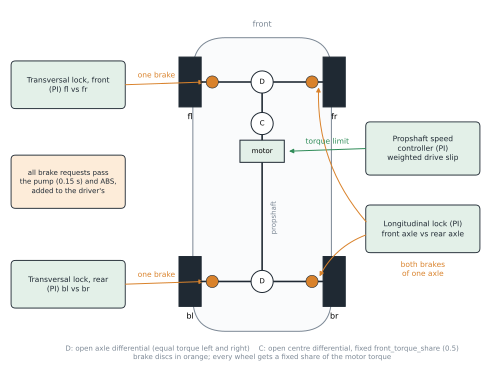
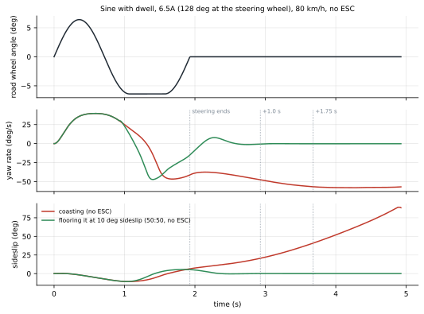
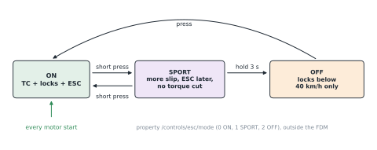
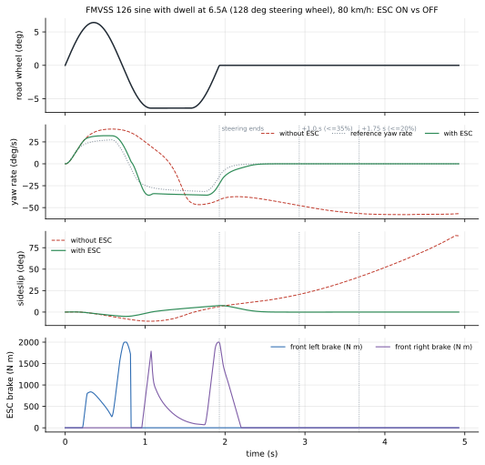

# Traction and Stability Control for the Tyre Model: Engineering Manual

Technical specification, control laws, parameter reference, and verification results for the
traction control (TC), drag torque control (EDTC/MSR), and electronic stability control (ESC)
subsystems of the Follow Me EV tyre and driveline model (`followme_e-tron-tyre`). This manual
complements `dev/tyre-model/README.md`, which documents the underlying brush/Pacejka-style tyre
force model, implicit wheel-speed integrator, hydraulic brake system, and four-wheel anti-lock
braking system (ABS).

All equations in this document correspond directly to the symbolic definitions in
`dev/tyre-model/generate.py` and the generated JSBSim system `Systems/tyre-model.xml`. Figures are
generated directly from standalone JSBSim time-domain runs by `dev/tyre-model/manual_figures.py`,
and the PDF manuals are rendered via headless Chrome by `dev/tyre-model/manual_pdf.py`.

---

## 1. Scope and System Boundary

The vehicle dynamics control suite comprises four functional modules:

1. **Traction Control System (TCS)**: Regulates the driven wheels to their optimal longitudinal slip
   region under acceleration by coordinating a fast propshaft-speed (motor-torque) controller with
   three brake-based differential lock controllers (one inter-axle longitudinal lock and two
   intra-axle transversal locks, also referred to as Electronic Differential Lock, EDL).
2. **Engine/Motor Drag Torque Control (EDTC / MSR)**: Prevents coast-down regenerative braking
   torque from inducing excessive negative (braking) slip on low-friction surfaces, thereby
   preserving lateral tyre force capacity during lift-off in curves.
3. **Electronic Stability Control (ESC / ESP)**: Tracks the driver's intended yaw rate and limits
   vehicle body sideslip by applying asymmetric stabilizing brake torques to individual wheels,
   selectively reducing driver brake pressure on yaw-aggravating inner wheels, and attenuating motor
   drive torque.
4. **Driver Interface and Diagnostics (Step 4)**: Provides a three-state operating mode selector
   (`ON`, `SPORT`, `OFF`), dashboard telltale lamps (`esc_sign`, `escoff_sign`), and hydraulic pump
   acoustic feedback.

All closed-loop force and torque calculations execute deterministically inside JSBSim at the full
flight-dynamics frame rate (120 Hz nominal, validated from 60 Hz to 240 Hz). Nasal scripts handle
only cockpit switching logic, lamp animations, and sound triggers. The legacy force-driven FDM
(`followme_e-tron`) has no rotational wheel states and is unaffected by this system.

---

## 2. Reference Standards and Literature

| ID | Reference | Engineering Application in Model |
|---|---|---|
| **S1** | K. Reif (ed.), *Brakes, Brake Control and Driver Assistance Systems*, Bosch Professional Automotive Information, Springer Vieweg, 2014, ISBN 978-3-658-03978-3. Chapters "Traction control system" and "Electronic stability program". | Four-wheel-drive TCS topology for open centre and axle differentials (Figs. 7–8); decoupled propshaft PID-like and differential-lock PI controllers; reference slip dependencies; EDTC/MSR logic; ESP hierarchical cascade above TCS/ABS; linear single-track reference yaw-rate model. |
| **S2** | Audi Service Training, Self-Study Programme 994475AG, *Audi ESC Systems*. | Functional partitioning between EDL (brake lock) and TCS (torque reduction); brake disc thermal derating concept; MSR lift-off stabilization; inner-wheel brake pressure reduction during oversteer braking; three-mode button state machine and telltale behavior. |
| **S3** | Volkswagen Self-Study Programme 374, *Traction Control and Assist Systems*. | EDL operating speed envelope; immediate EDL release upon driver brake-pedal application; thermal cut-out protection; pure torque-based TCS operation above 80 km/h. |
| **S4** | Institut für Kraftfahrwesen Aachen (ika) for CITA, Report 8329, *A Test Procedure for Vehicle Dynamic Controllers*. | Empirical controller models and telemetry for a Mercedes-Benz A-Class and a BMW 330xi (AWD) calibrated against 55 km/h dry/wet double-lane-change tests: cornering slip-threshold reduction, ESC yaw-rate error thresholds, brake torque magnitudes, hydraulic build-up times, and sideslip limitation with cyclic damping. |
| **S5** | BMW Technical Training, *E46 Traction and Stability Control Systems*. | Hydraulic pre-charge and return-pump pressure build-up during active TC/ESC interventions; default-ON startup rule; SPORT mode slip-threshold elevation below 68 km/h (42 mph). |
| **S6** | Audi A4 (B5) Workshop Manual, *ABS/ESP System Description ("EDL" and "TCS")*. | Four-wheel-drive EDL engagement ceiling (40 km/h) and upper cut-out speed (80 km/h); brake disc temperature hysteresis with upper cut-out and lower re-engagement thresholds. |
| **S7** | Audi MediaInfo, *In Search of Driving Pleasure: quattro Drive and Suspension of the Audi e-tron*, 15 Sept 2021. | Millisecond-level electric drive torque modulation in power electronics; 150 ms hydraulic pressure build-up to full clamping force; retention of low-speed brake slip control in ESC OFF mode. |
| **S8** | NHTSA FMVSS No. 126 (49 CFR 571.126), *Electronic Stability Control Systems* Final Rule, 2007 (equivalent to UN ECE Regulation No. 140). | Slowly Increasing Steer (SIS) characterization maneuver; 80 km/h Sine with Dwell (SwD) stability and responsiveness acceptance criteria; minimum activation speed (20 km/h); ignition reset and telltale requirements. |
| **S9** | NHTSA Report DOT HS 809 747 (archived in `Docs/ABS/`). | Baseline four-channel ABS slip-regulation and split-mu yaw-delay behavior underneath TC and ESC. |

*Note on repository policy*: References S1–S7 are copyrighted engineering publications kept locally
in `Docs/ESC/` and excluded from version control via `.gitignore`. S8 and S9 are public-domain U.S.
government documents. Because traction control acceleration performance is not mandated by regulation
and OEM low-friction launch telemetry is unpublished, TC is verified against theoretical friction
limits and the qualitative invariants defined in S1–S7, whereas ESC is verified directly against the
mandatory FMVSS No. 126 (S8) certification test series.

---

## 3. Vehicle Plant and Open-Loop Baseline Dynamics

### 3.1 Powertrain and Brake Actuation Plant

The vehicle is propelled by a single electric motor rated at $T_{m,\max} = 460\text{ N}\cdot\text{m}$
and $P_{m,\max} = 375\text{ kW}$, coupled through a fixed single-speed reduction gear ($G = 9.73$)
to an open centre differential with a nominal torque distribution of
$s = \text{front\_torque\_share} = 0.50$, which in turn drives open front and rear axle
differentials. This driveline is identical to the four-wheel-drive plant analysed in S1 (Figs. 7 and
8, *"Drive concept of a four-wheel-drive vehicle with TCS"*).



*Figure 1. Plan view of the single-motor, three-open-differential all-wheel-drive plant and the four
decoupled traction controllers described in Section 6.*

By the kinematics of open differentials, the motor shaft angular velocity $\omega_m$ is the
torque-weighted mean of the four wheel angular velocities $\omega_w$ ($w \in \{fl, fr, bl, br\}$):

$$\omega_m = G \left[ s \frac{\omega_{fl} + \omega_{fr}}{2} + (1 - s) \frac{\omega_{bl} + \omega_{br}}{2} \right]$$

Each half-shaft receives a fixed share of the net motor shaft torque $T_m$:

$$T_{\text{drive},fl} = T_{\text{drive},fr} = \frac{1}{2} s G T_m, \qquad T_{\text{drive},bl} = T_{\text{drive},br} = \frac{1}{2} (1 - s) G T_m$$

At $s = 0.50$ and full motor torque ($460\text{ N}\cdot\text{m}$), each wheel receives up to
$1119\text{ N}\cdot\text{m}$ of drive torque. The hydraulic service brake system provides a
full-pedal capacity of $T_{\text{brake,front}} = 2300\text{ N}\cdot\text{m}$ per front wheel and
$T_{\text{brake,rear}} = 836\text{ N}\cdot\text{m}$ per rear wheel (sized for a $1.15\,g$ front-first
lockup balance). All four service brakes are governed by the four-channel ABS (`dev/tyre-model/README.md`),
which normally enforces independent front control with a split-mu yaw-moment build-up delay and
rear-axle select-low control.

### 3.2 Mass Properties and Steady-State Handling Characteristics

| Parameter | Value | Engineering Note |
|---|---|---|
| Total mass with 60 kg driver ($m$) | $1635\text{ kg}$ ($52\%$ front / $48\%$ rear) | Component build-up in `dev/tyre-model/mass.py`; CG height $h_{\text{cg}} \approx 0.46\text{ m}$ |
| Wheelbase ($L$) and track ($b$) | $L = 2.480\text{ m}$, $b = 1.320\text{ m}$ | Read from structural contact points in `followme_e-tron.xml` |
| Yaw moment of inertia ($I_{zz}$) | $1830\text{ kg}\cdot\text{m}^2$ | Dynamic index $I_{zz} / (m l_f l_r) = 0.72$; comparable to S4's A-Class ($0.66$) and BMW 330xi ($0.85$) |
| Suspension & roll stiffness distribution | $78.8\text{ kN/m}$ per corner, $50:50$ | No anti-roll bars; KIT tyre cornering stiffness is nearly proportional to vertical load below $4\text{ kN}$ |
| Understeer gradient ($K_{\text{us}}$) | $0.11^\circ/g$ at $40\text{ km/h}$, $0.21^\circ/g$ at $80\text{ km/h}$, $0.30^\circ/g$ at $120\text{ km/h}$ | Linear-range steady-state circle fit up to $a_y = 4\text{ m/s}^2$; mildly understeering / nearly neutral |
| Characteristic speed ($v_{\text{char}}$) | $111\text{ m/s}$ at $40\text{ km/h}$, **$82\text{ m/s}$ at $80\text{ km/h}$**, $68\text{ m/s}$ at $120\text{ km/h}$ | $v_{\text{char}} = \sqrt{L / K_{\text{us}}}$; ESC reference model uses the $80\text{ km/h}$ value ($82\text{ m/s}$) |

### 3.3 Open-Loop Baseline Without TC or ESC

Table 1 summarizes the open-loop behavior of the vehicle in standalone JSBSim at 120 Hz on flat
ground when both TC and ESC are disabled (`tc/par/enabled = 0`, `esc/par/enabled = 0`). Normalized
drive slip is reported as a multiple of each tyre's load-dependent peak drive slip.

| Test Condition | Open-Loop Behavior (No TC, No ESC) |
|---|---|
| Dry asphalt ($\mu = 1.0$), $50:50$, full throttle | $0\text{--}100\text{ km/h}$ in $3.64\text{ s}$; rearward load transfer unloads the front axle, causing the lighter front-right wheel to spin to $6.7\times$ its peak slip (front-left $0.65\times$). |
| Dry asphalt ($\mu = 1.0$), $30:70$ rear bias, full throttle | $0\text{--}100\text{ km/h}$ in $3.43\text{ s}$; matches dynamic axle loads, no wheel exceeds peak slip. |
| Low grip ($\mu \times 0.3$), $50:50$, full throttle | $0\text{--}100\text{ km/h}$ in $11.94\text{ s}$ (theoretical friction limit is $8.6\text{ s}$); all four wheels flare to $\sim 150\times$ peak slip against the $3000\text{ rad/s}$ motor speed limiter, operating in the $75\%$ sliding-friction regime. |
| Low grip ($\mu \times 0.3$), $30:70$ rear bias, full throttle | Rear axle breaks traction first; lower yaw inertia allows the vehicle to spin out ($> 120^\circ$ heading loss). |
| Split grip (left $\mu = 1.0$, right $\mu \times 0.3$), full throttle | $0\text{--}60\text{ km/h}$ in $5.6\text{ s}$; right-side wheels flare to $140\times$ peak slip. |
| Split ice (left $\mu = 1.0$, right $\mu \times 0.1$), full throttle | $0\text{--}60\text{ km/h}$ in $16.73\text{ s}$; right-side wheels spin to $> 200\times$ peak slip and drive the motor into its $3000\text{ rad/s}$ rev limiter, which cuts torque to the gripping left wheels. |
| FMVSS 126 Sine with Dwell ($80\text{ km/h}$, coasting, $A = 19.7^\circ$) | Across the 52-run series ($1.5A$ to $270^\circ$ left and right), **38 runs fail** the yaw-decay criteria and **13 result in complete spin-outs** ($\beta \to 89^\circ$). |
| Sine with Dwell at $6.5A$ ($128^\circ$), full throttle applied at $\beta = 10^\circ$ | With $50:50$ or front-wheel drive, applying full power pulls the nose straight ($\beta_{\max} \le 18^\circ$); with $30:70$ or rear-wheel drive, power accelerates the spin. |



*Figure 2. Open-loop response to the FMVSS 126 Sine with Dwell maneuver at $6.5A$ ($128^\circ$
steering-wheel amplitude) and $80\text{ km/h}$ without ESC. While coasting (red), the vehicle fails
to arrest its negative yaw rate after steering reversal completes and spins out ($\beta \approx
90^\circ$). Flooring the accelerator at $10^\circ$ sideslip (green) recovers the vehicle under
$50:50$ drive, demonstrating the stabilizing forward traction vector of the front axle.*

---

## 4. Control System Architecture and Signal Interface

### 4.1 Frame Execution Order

Within each JSBSim integration step ($\Delta t = 1/120\text{ s} \approx 8.33\text{ ms}$ nominal),
system channels execute sequentially from left to right:

```
Occupants -> Traction and stability control -> Driveline -> Brakes -> ABS -> Tyre fl, fr, bl, br
```


*Figure 3. Signal flow across JSBSim channels within a single FDM frame. The `Traction and stability
control` channel samples the previous frame's tyre and body states and outputs motor torque limits
and per-wheel stability brake commands for the current frame.*

### 4.2 Hierarchical Cascade Structure

Following Bosch's vehicle dynamics hierarchy (S1), the control architecture is strictly layered:

- **Supervisory Layer (ESC)**: Evaluates whole-vehicle lateral dynamics (yaw rate $r$ and body
  sideslip angle $\beta$ against the driver's steering angle $\delta$) and modifies the inputs of
  the underlying longitudinal controllers via a multiplicative motor torque factor
  (`esc/torque_factor`), additive per-wheel hydraulic brake requests (`esc/brake_<w>`), and
  multiplicative inner-wheel driver brake pressure retention factors (`esc/keep_<w>`).
- **Traction Layer (TCS & EDTC)**: Regulates propshaft slip via the motor torque limit
  (`tc/motor_cap_nm`), regulates inter-wheel and inter-axle slip differences via brake lock requests
  (`tyre/<w>/tc_lock_nm`, `tc/lock_front_nm`, `tc/lock_rear_nm`), and limits coast-down drag torque
  via `tc/drag_factor`.
- **Wheel-Slip Protection Layer (ABS)**: Every hydraulic brake torque command—whether initiated by
  the driver's foot pedal, AEB/cruise control, Auto Hold, a TC differential lock, or an ESC yaw
  intervention—enters the `ABS` channel before reaching the wheel. Consequently, **no upstream
  controller can lock a wheel**; if an ESC or TC brake request exceeds the local road grip, ABS
  automatically modulates the wheel near its peak braking slip.

### 4.3 Actuator Interfaces

1. **Motor Drive Torque Limitation (`tc/motor_cap_nm` and `esc/torque_factor`)**:
   In the `Driveline` channel, the driver's raw pedal torque demand `driveline/request_torque_nm` is
   clamped by `tc/motor_cap_nm` and scaled by `esc/torque_factor` to yield the actual electromagnetic
   drive torque `driveline/drive_torque_nm`:
   $$T_{\text{drive}} = T_{\text{req}} \cdot \min\!\left(1,\; \frac{T_{\text{cap,TC}}}{\max(|T_{\text{req}}|, 0.001)}\right) \cdot f_{\text{ESC}}$$
   Because inverter torque control operates at the millisecond scale (S7), torque reductions take
   effect within the same FDM frame without phase lag. `Nasal/engine.nas` reads `drive_torque_nm`
   so battery power consumption reflects actual delivered torque.
2. **Coast Regeneration Scaling (`tc/drag_factor`)**:
   Attenuates `driveline/coast_torque_nm` toward zero when EDTC detects excessive negative wheel
   slip during coasting:
   $$T_m = \text{motor\_on} \cdot \left[ T_{\text{drive}} + T_{\text{coast}} \cdot f_{\text{drag}} \cdot (1 - \text{abs\_any}) \right]$$
3. **Stability Brake Addition (`tyre/<w>/stab_brake_nm`)**:
   The sum of the transversal lock, longitudinal lock, and ESC brake torque requests on wheel $w$,
   rate-limited on pressure build-up by the hydraulic return pump (`tc/par/pump_time_s = 0.15 s` for
   full-pedal torque) and added to the driver's service brake demand upstream of ABS.
4. **Driver Brake Pressure Reduction (`esc/keep_<w>`)**:
   Scales the driver's service brake request on wheel $w$ prior to adding `stab_brake_nm`:
   $$T_{\text{req,ABS},w} = \min\!\left(T_{\text{brake,max},w},\; u_{\text{service,axle}} T_{\text{brake,max},w} \cdot k_{\text{ESC},w} + T_{\text{stab},w}\right)$$

### 4.4 Sensor and State Inputs

| Physical Quantity | Production Vehicle (S1, S2) | JSBSim Model Implementation |
|---|---|---|
| Wheel angular speed $\omega_w$ | Wheel-speed encoder / inverter resolver | Exact state `tyre/<w>/omega_rad_sec` |
| Contact-patch ground velocity $v_{x,w}$ | Estimated from non-driven/gripping wheels + $a_x$ | True kinematic projection `tyre/<w>/vx_wheel_mps` |
| Yaw rate $r$ and lateral acceleration $a_y$ | MEMS gyro and lateral accelerometer | True body-frame `velocities/r-rad_sec` and `accelerations/Ny` |
| Front road-wheel steering angle $\delta$ | Steering-column angle sensor $\div i_s$ | `fcs/steer-pos-deg[0]` (max $45^\circ$ for $900^\circ$ handwheel) |
| Vehicle body sideslip angle $\beta$ | Luenberger / Kalman state observer | True kinematic $\arctan(v / \max(|u|, 0.3\text{ m/s}))$ |
| Tyre-road peak friction $\mu_{\text{lat}}$ | Estimated from $(a_x, a_y)$ utilization envelope | True load- and surface-scaled `tyre/<w>/mu_y` |

---

## 5. Normalized State Variables and Feedback Signals

Because the KIT 205/55 R17 tyre exhibits a strong vertical-load dependence in its peak longitudinal
slip ($\kappa_{\text{peak,drive}} = 18.0\%, 14.5\%, 8.5\%$ and $\kappa_{\text{peak,brake}} = 20.5\%,
14.0\%, 10.5\%$ at $F_z = 1250, 4000, 6000\text{ N}$), all slip controllers operate in
**load-normalized slip coordinates** where $1.0$ represents the tyre's exact grip peak at its
instantaneous vertical load:

1. **Normalized Wheel Drive Slip (`tyre/<w>/tc_slip`)**:
   $$n_w = \frac{\kappa_w \cdot d}{\kappa_{\text{peak,drive}}(F_{z,w})}$$
   where $\kappa_w = (\omega_w R - v_{x,w}) / \max(|v_{x,w}|, v_{\text{low}})$ is the longitudinal
   slip ratio and $d \in \{+1, -1\}$ is the selected drive direction (`driveline/in/direction`).
   Thus $n_w > 0$ whenever the wheel rotates faster than the ground in the intended direction of
   travel (including reverse gear and forward drive while rolling backward on a grade).
2. **Normalized Wheel Braking Slip (`tyre/<w>/tc_brake_slip`)**:
   $$b_w = \frac{\max(0,\; -\kappa_w \operatorname{sgn}(v_{x,w}))}{\kappa_{\text{peak,brake}}(F_{z,w})}$$
3. **Measured Propshaft Slip (`tc/raw_slip`)**:
   The torque-share-weighted average of the four wheels' measured drive slips, corresponding to the
   normalized excess speed of the centre differential input shaft:
   $$n_{\text{raw}} = s \frac{n_{fl} + n_{fr}}{2} + (1 - s) \frac{n_{bl} + n_{br}}{2}$$
4. **Effective Lateral Friction and Cornering Utilization (`tc/mu_lateral`, `tc/lateral_use`)**:
   $$\mu_{\text{lat}} = \frac{1}{4}\sum_{w} \mu_{y,w}, \qquad u_y = \min\!\left(1.0,\; \frac{|N_y|}{\max(\mu_{\text{lat}}, 0.05)}\right)$$
   where $N_y = a_y / g$ is the lateral load factor in $g$.

---

## 6. Traction Control System (TCS) and Drag Torque Control (EDTC)

Following S1, the four-wheel-drive traction control system is partitioned into three brake-based
differential lock controllers that eliminate slip **differences** between wheels and axles, and one
propshaft speed controller that regulates the **common** slip shared by the driven wheels through
the motor torque.


*Figure 4. Detailed signal flow of the four-controller traction control system. The transversal and
longitudinal brake locks absorb inter-wheel and inter-axle slip disparities; only the uncompensated
residual slip $r_w$ (plus soft-saturation overflow when a brake reaches its physical torque ceiling)
is passed to the motor controller.*

### 6.1 Transversal Differential Lock Controllers (Intra-Axle EDL)

One PI controller with hysteresis operates per axle, comparing each wheel's normalized drive slip
$n_w$ against its axle partner $n_{\text{partner}}$ (`fl` vs `fr`, and `bl` vs `br`):

1. **Hysteresis Error Law**:
   To prevent nuisance brake dragging on uniform roads while still pulling a genuinely spinning
   wheel back to its grip peak once triggered, the controller employs a two-threshold hysteresis
   deadband on the inter-wheel slip difference:
   $$d_w = \begin{cases} d_{\text{rel}} = 0.10 & \text{if } T_{\text{lock,state},w} > 0 \\ d_{\text{eng}} = 0.50 & \text{if } T_{\text{lock,state},w} = 0 \end{cases}$$
   $$e_{\text{lock},w} = \min\!\left(n_w - n_{\text{lock,target}},\; n_w - n_{\text{partner}} - d_w\right)$$
   where $n_{\text{lock,target}} = 1.0$. An idle lock does not engage until the wheel both exceeds
   its grip peak ($n_w > 1.0$) and slips at least $0.50$ more than its partner. Once engaged
   ($T_{\text{lock,state},w} > 0$), it regulates the faster wheel back down to $n_{\text{lock,target}} = 1.0$
   and remains active until the left-right difference narrows below $d_{\text{rel}} = 0.10$.
2. **Speed, Pedal, and Thermal Gating**:
   In accordance with S3 and S6, the lock is enabled (`tc_lock_on = 1`) only when the accelerator is
   pressed (`throttle_norm > 0.01`), the service brake pedals are released (`< 0.02`), the axle is
   driven, and vehicle speed is below $v_{\text{eng}} = 40\text{ km/h}$ (or remains below
   $v_{\text{cut}} = 80\text{ km/h}$ while $T_{\text{lock,state},w} > 0$).
3. **Pump-Synchronized Anti-Windup and Requested-Torque Ceiling**:
   The maximum drive torque the open differential can deliver to wheel $w$ for the driver's current
   pedal position is:
   $$T_{\text{req},w} = \frac{1}{2} s_{\text{axle}} G |T_{\text{req}}|$$
   The integral state $T_{\text{lock,state},w}$ is constrained so that it never runs ahead of what
   the hydraulic pump can physically build by the next frame, and the total lock output
   $T_{\text{lock},w}$ is bounded by both the wheel's full-pedal brake capacity $T_{\text{brake,max},w}$
   and the driver's requested wheel drive torque $T_{\text{req},w}$:
   $$T_{\text{lock,state},w}[k] = \text{on}_w \cdot \max\!\left(0,\; \min\!\left(T_{\text{brake,max},w},\; T_{\text{stab},w}[k-1] + \frac{\Delta t}{\tau_{\text{pump}}} T_{\text{brake,max},w},\; T_{\text{lock,state},w}[k-1] + \Delta t \, K_{I,\text{lock}} e_{\text{lock},w} T_{w,\max}\right)\right)$$
   $$T_{\text{lock},w}[k] = \text{on}_w \cdot f_{\text{temp},w} \cdot \max\!\left(0,\; \min\!\left(T_{\text{brake,max},w},\; T_{\text{req},w},\; T_{\text{lock,state},w}[k] + K_{P,\text{lock}} e_{\text{lock},w} T_{w,\max}\right)\right)$$
   where $T_{w,\max} = \frac{1}{2} s_{\text{axle}} G T_{m,\max}$, $K_{P,\text{lock}} = 0.2$, and
   $K_{I,\text{lock}} = 8.0\text{ s}^{-1}$. Capping the lock at the *pre-TC* requested wheel torque
   $T_{\text{req},w}$ (rather than post-TC `drive_torque_nm`) prevents the front brake from
   over-braking above $1119\text{ N}\cdot\text{m}$ while ensuring the lock does not dump hydraulic
   pressure whenever the motor controller momentarily trims torque.
4. **Residual Slip Handoff (`tyre/<w>/tc_resid`)**:
   While a lock is active and below its physical brake torque ceiling ($T_{\text{lock},w} \le 0.98\,T_{\text{brake,max},w}$),
   the slip error it is actively absorbing is subtracted from $n_w$. If the wheel's brake reaches
   saturation (which occurs on the rear axle where $T_{\text{brake,rear}} = 836\text{ N}\cdot\text{m} < 1119\text{ N}\cdot\text{m}$),
   a soft-saturation clamp passes at most $0.5$ of slip above the single-wheel limit
   $n_{\text{wheel\_limit}} = 1.4$ to the motor controller, preventing a sudden step dump of raw
   ice-wheel slip from collapsing motor torque to zero:
   $$r_w = \begin{cases} \min(n_w,\; n_{\text{wheel\_limit}} + 0.5) & \text{if } \text{on}_w = 1 \text{ and } T_{\text{lock},w} > 0.98\,T_{\text{brake,max},w} \\ n_w - \text{on}_w f_{\text{temp},w} \max(0, e_{\text{lock},w}) & \text{otherwise} \end{cases}$$

### 6.2 Longitudinal Differential Lock Controller (Inter-Axle Lock)

When both axles are driven ($0 < s < 1$), an identical PI controller with hysteresis compares the
front and rear axle mean residual slips:

$$n_{\text{axle,front}} = \frac{r_{fl} + r_{fr}}{2}, \qquad n_{\text{axle,rear}} = \frac{r_{bl} + r_{br}}{2}$$

If one axle slips more than the other beyond the hysteresis deadband ($0.50$ engage, $1.0$ target,
$0.10$ release), symmetric brake torque $T_{\text{lock,axle}}$ is applied to both wheels of the
faster-slipping axle (emulating a centre differential lock), and the absorbed inter-axle slip
difference is deducted to form the axle propshaft inputs $n_{\text{prop,front}}$ and
$n_{\text{prop,rear}}$.

### 6.3 Propshaft Speed Controller (Motor Torque PID-Like Controller)

The motor controller regulates the residual propshaft slip:

$$n_{\text{prop}} = s \, n_{\text{prop,front}} + (1 - s) \, n_{\text{prop,rear}}$$


*Figure 5. Left: dry longitudinal force curve at $F_z = 4000\text{ N}$ showing the motor target
($0.85$), the single-wheel limit ($1.40$), and the onset of tread sliding ($1.50$). Middle:
cornering reference slip $n_{\text{ref}}$ as a function of normalized lateral acceleration $u_y$.
Right: thermal derating factor $f_{\text{temp}}$ versus brake disc temperature.*

1. **Cornering Reference Slip (`tc/target`)**:
   From the friction ellipse (matching S1 and S4's one-third cornering threshold reduction), the
   allowable longitudinal target slip decreases as lateral force consumes the tyre's grip budget:
   $$n_{\text{ref}} = n_{\text{target}} \cdot \max\!\left(c_{\min},\; \sqrt{\max(0,\; 1 - u_y^2)}\right)$$
   with $n_{\text{target}} = 0.85$ and $c_{\min} = 0.40$.
2. **Time-Step-Invariant Filtered Derivative on Measured Slip (`tc/slip_rate`)**:
   To arrest the initial low-friction wheelspin flare before the wheels cross their grip peak—and to
   provide phase lead that stops motor torque cuts as soon as a braked wheel begins decelerating—a
   derivative term acts on the measured propshaft slip $n_{\text{raw}}$ through a first-order
   low-pass filter of time constant $\tau_d = 0.025\text{ s}$:
   $$\dot{n}_{\text{filt}}[k] = \dot{n}_{\text{filt}}[k-1] + \frac{\Delta t}{\tau_d + \Delta t}\left(\frac{n_{\text{raw}}[k] - n_{\text{raw}}[k-1]}{\Delta t} - \dot{n}_{\text{filt}}[k-1]\right) = \frac{n_{\text{raw}}[k] - n_{\text{raw}}[k-1] + \tau_d \dot{n}_{\text{filt}}[k-1]}{\tau_d + \Delta t}$$
   Because $\Delta t$ cancels analytically between the finite difference and the filter gain, this
   expression avoids dividing by $\Delta t$, suppresses high-frequency switching noise at 240 Hz,
   and produces identical trajectories across 60, 120, and 240 Hz.
3. **Composite Slip Error with Single-Wheel Guard (`tc/error`)**:
   Above $80\text{ km/h}$ (where the brake locks cut out), a single wheel on a low-friction patch
   could spin up while the four-wheel mean remained below $n_{\text{ref}}$. A single-wheel ceiling
   $n_{\text{wheel\_limit}} = 1.40$ (just below the sliding onset at $1.50$) guards the fastest
   residual wheel $n_{\text{wheel\_max}} = \max_w r_w$:
   $$e_m = \min\!\left(e_{\max},\; \max\!\left(n_{\text{prop}} + t_d \dot{n}_{\text{filt}} - n_{\text{ref}},\; n_{\text{wheel\_max}} - n_{\text{wheel\_limit}}\right)\right)$$
   with look-ahead time $t_d = 0.025\text{ s}$ and error clamp $e_{\max} = 2.0$.
4. **Integral-State Torque Limit (`tc/cap_nm` and `tc/motor_cap_nm`)**:
   The controller's integral state is the motor torque limit $T_{\text{cap}}$ itself, initialized
   to and bounded above by the driver's instantaneous torque request $|T_{\text{req}}|$ so that
   integrator wind-up is impossible:
   $$T_{\text{cap}}[k] = \max\!\left(0,\; \min\!\left(T_{m,\max},\; \min(T_{\text{cap}}[k-1], |T_{\text{req}}|) - \Delta t \, T_{m,\max} \, e_m \, R(e_m)\right)\right)$$
   $$T_{\text{cap,TC}}[k] = \max\!\left(0,\; T_{\text{cap}}[k] - K_{P,m} e_m T_{m,\max}\right)$$
   where $R(e_m) = K_{\text{cut}} = 10.0\text{ s}^{-1}$ when $e_m > 0$ (fast torque reduction) and
   $R(e_m) = K_{\text{restore}} = 5.0\text{ s}^{-1}$ when $e_m \le 0$ (controlled torque recovery),
   and $K_{P,m} = 0.30$.

### 6.4 Hydraulic Brake Path, Pump Dynamics, and ABS Override

Each wheel's total stability brake target combines its transversal lock, axle longitudinal lock, and
ESC brake commands:

$$T_{\text{stab,target},w} = \min\!\left(T_{\text{brake,max},w},\; \min(T_{\text{req},w},\; T_{\text{lock},w} + T_{\text{lock,axle}}) + T_{\text{ESC},w}\right)$$

The hydraulic return pump builds pressure at a maximum slew rate of $T_{\text{brake,max},w} / \tau_{\text{pump}}$
with $\tau_{\text{pump}} = 0.15\text{ s}$ (matching S7's 150 ms full-pressure build time and S4's
$0.05\text{--}0.15\text{ s}$ range), while pressure release is immediate:

$$T_{\text{stab},w}[k] = \min\!\left(T_{\text{stab,target},w}[k],\; T_{\text{stab},w}[k-1] + \frac{\Delta t}{\tau_{\text{pump}}} T_{\text{brake,max},w}\right)$$

When $T_{\text{stab},w} > 0$ on either rear wheel, the `ABS` channel disables rear select-low and
regulates each rear wheel independently; when $T_{\text{stab},w} > 0$ on a front wheel, the front
split-mu yaw-moment build-up delay is bypassed on that wheel.

### 6.5 Brake Disc Thermal Model and Lock Derating

To replicate the thermal protection of production EDL systems (S2, S6), each brake disc's
temperature $T_{d,w}$ ($^\circ\text{C}$) is integrated using a lumped-capacitance energy balance
driven by total friction braking power (both driver and stability braking) and convective cooling:

$$m_{d,w} c_d \frac{dT_{d,w}}{dt} = \left(T_{\text{service},w} + T_{\text{mech},w}\right) |\omega_w| - \left(h_0 + h_1 |v_{x,w}|\right)\left(T_{d,w} - T_{\text{amb}}\right)$$

with grey cast-iron specific heat $c_d = 460\text{ J/(kg}\cdot\text{K)}$, disc masses
$m_{d,\text{front}} = 9\text{ kg}$ and $m_{d,\text{rear}} = 7\text{ kg}$, static cooling coefficient
$h_0 = 20\text{ W/K}$, speed-dependent cooling coefficient $h_1 = 2.0\text{ W/(K}\cdot\text{m/s)}$,
and ambient temperature $T_{\text{amb}} = 20\,^\circ\text{C}$. The differential locks' torque output
is scaled by:

$$f_{\text{temp},w} = \operatorname{clip}\!\left(\frac{T_{\text{off}} - T_{d,w}}{T_{\text{off}} - T_{\text{fade}}},\; 0,\; 1\right), \qquad T_{\text{fade}} = 450\,^\circ\text{C},\quad T_{\text{off}} = 550\,^\circ\text{C}$$

### 6.6 Engine/Motor Drag Torque Control (EDTC / MSR)

When the driver lifts off the accelerator on a low-friction surface, coast regeneration torque acts
as an unmodulated brake torque outside ABS. Whenever the maximum normalized braking slip across the
driven wheels $b_{\max} = \max_w b_w$ exceeds $b_{\text{drag}} = 0.35$, the scaling factor
$f_{\text{drag}} \in [0, 1]$ ramps down at $K_{\text{drag,cut}} = 20.0\text{ s}^{-1}$ and recovers at
$K_{\text{drag,restore}} = 2.0\text{ s}^{-1}$ once $b_{\max} \le 0.35$:

$$f_{\text{drag}}[k] = \operatorname{clip}\!\left(f_{\text{drag}}[k-1] + \Delta t \begin{cases} -K_{\text{drag,cut}} & \text{if } b_{\max} > 0.35 \\ +K_{\text{drag,restore}} & \text{if } b_{\max} \le 0.35 \end{cases},\; 0,\; 1\right)$$

Setting $b_{\text{drag}} = 0.35$ (35% of peak longitudinal braking slip) ensures coast regeneration
is released while at least $\sqrt{1 - 0.35^2} \approx 94\%$ of the tyre's lateral friction capacity
remains available for cornering stability.

---

## 7. Electronic Stability Control (ESC)

ESC operates in forward travel above $v_{\min,\text{ESC}} = 20\text{ km/h}$ (S8). It combines a
vehicle-specific single-track reference model (S1) with continuous, friction-scaled brake and motor
torque interventions calibrated from S4's four-wheel-drive thresholds.

### 7.1 Single-Track Reference Yaw Rate and Phase Matching

From the linear two-degree-of-freedom bicycle model, the steady-state yaw rate commanded by a front
road-wheel steering angle $\delta$ at longitudinal speed $v_x$ is:

$$r_{\text{ss}} = \frac{v_x \, \delta}{L \left(1 + \left(v_x / v_{\text{char}}\right)^2\right)}$$

where $L = 2.480\text{ m}$ and $v_{\text{char}} = 82.0\text{ m/s}$ is this vehicle's measured
characteristic speed at $80\text{ km/h}$. Using the host vehicle's own $v_{\text{char}}$ is essential:
substituting S4's more strongly understeering BMW 330xi value ($16.7\text{ m/s}$) would underestimate
$r_{\text{ss}}$ by more than half at $80\text{ km/h}$ and falsely trigger oversteer interventions in
gentle $0.3\,g$ turns.

Because steady-state lateral acceleration cannot exceed the road's friction limit $\mu_{\text{lat}} g$,
the reference yaw rate magnitude is bounded by:

$$r_{\text{lim}} = \frac{\mu_{\text{lat}} g}{\max(v_x, 1.0\text{ m/s})}$$

To match the transient phase lag between steering wheel input and body yaw response (represented by
an all-pass filter in S4), two first-order lag states with time constant $\tau_{\text{ref}} = 0.10\text{ s}$
are maintained:

1. **Brake-Intervention Reference (`esc/ref`)**, clamped strictly at $1.0\,r_{\text{lim}}$:
   $$\dot{r}_{\text{ref}} = \frac{\operatorname{clip}(r_{\text{ss}}, -r_{\text{lim}}, +r_{\text{lim}}) - r_{\text{ref}}}{\tau_{\text{ref}}}$$
2. **Understeer Torque-Cut Reference (`esc/ref_us`)**, clamped at $1.5\,r_{\text{lim}}$:
   $$\dot{r}_{\text{ref,us}} = \frac{\operatorname{clip}(r_{\text{ss}}, -1.5\,r_{\text{lim}}, +1.5\,r_{\text{lim}}) - r_{\text{ref,us}}}{\tau_{\text{ref}}}$$

*Design rationale*: On low friction, when a driver turns the steering wheel well past the tyre grip
limit, clamping the reference at $1.0\,r_{\text{lim}}$ leaves almost zero difference between
$r_{\text{ref}}$ and $r$. Allowing the *torque-cut* reference $r_{\text{ref,us}}$ to reach
$1.5\,r_{\text{lim}}$ enables ESC to recognize excessive steering demand under power and reduce motor
torque, while keeping the *inner-rear brake* reference strictly capped at $1.0\,r_{\text{lim}}$ so
that inner-rear braking does not destabilize the rear axle during extreme Sine-with-Dwell reversals.

### 7.2 Closed-Loop Yaw and Sideslip Control Laws

With turn direction $\sigma = \operatorname{sgn}(r) \in \{+1, -1\}$ and bend detection active when
$|r| > r_{\text{bend}} = 0.05\text{ rad/s}$ ($2.9^\circ/\text{s}$), the signed oversteer and
understeer yaw-rate errors are:

$$e_{\text{os}} = \text{bend} \cdot (r - r_{\text{ref}})\sigma, \qquad e_{\text{us}} = \text{bend} \cdot (r_{\text{ref}} - r)\sigma, \qquad e_{\text{us,drive}} = \text{bend} \cdot (r_{\text{ref,us}} - r)\sigma$$

All ESC brake torque commands are scaled by effective lateral grip $g_\mu = \min(1.0, \mu_{\text{lat}})$
so that low-friction interventions apply proportional clamping forces rather than slamming the wheel
into deep ABS cycling:

| Control Mode | Activation Range | Control Law and Target Actuators | Source Basis |
|---|---|---|---|
| **Deadband / Linear Regime** | $|r| \le 0.05\text{ rad/s}$ or $\max(e_{\text{os}}, e_{\text{us,drive}}) \le 0.07\text{ rad/s}$ and $|\beta| \le 10^\circ$ | No intervention ($T_{\text{ESC},w} = 0$, $k_{\text{ESC},w} = 1$, $f_{\text{ESC}} = 1$). Prevents intrusion during normal driving up to $8\text{ m/s}^2$. | S1, S4, S8 |
| **Oversteer Yaw Braking** | $e_{\text{os}} \in [0.07, 0.15]\text{ rad/s}$ ($4.0^\circ/\text{s}\text{ to }8.6^\circ/\text{s}$) | Linear ramp on **outer front wheel** (`fl` in right turn, `fr` in left turn) from $0$ to $g_\mu d_\beta \cdot 2000\text{ N}\cdot\text{m}$, generating a restoring counter-yaw moment. | S1, S4 |
| **Oversteer Inner-Wheel Pressure Release** | $e_{\text{os}} \in [0.07, 0.15]\text{ rad/s}$ while driver is braking | Reduces driver brake pressure on the **inner front and inner rear wheels** linearly from $100\%$ down to $k_{\text{ESC}} = 20\%$ (`release_share = 0.80`), eliminating pro-spin braking forces on split-mu and corner-braking. | S2, S8 |
| **Understeer Yaw Braking** | $e_{\text{us}} \in [0.07, 0.10]\text{ rad/s}$ ($4.0^\circ/\text{s}\text{ to }5.7^\circ/\text{s}$) | Linear ramp on **inner rear wheel** (`br` in right turn, `bl` in left turn) from $0$ to $g_\mu d_\beta \cdot 600\text{ N}\cdot\text{m}$, pulling the nose into the turn. | S1, S4 |
| **Sideslip Limitation** | $\|\beta\| \in [10^\circ, 12^\circ]$ | Overrides yaw-rate braking and brakes the **front wheel on the sliding side** (`fl` for $\beta < 0$, `fr` for $\beta > 0$) from $300\,g_\mu$ to $600\,g_\mu\text{ N}\cdot\text{m}$. Each exit multiplies the yaw-control damping factor $d_\beta$ by $0.60$ (resetting to $1.0$ when $\|\delta\| < 1^\circ$ and $\|r\| < 0.05\text{ rad/s}$) to suppress oscillatory counter-swings on ice. | S4 |
| **Motor Torque Reduction** | $\max(e_{\text{os}}, e_{\text{us,drive}}) \in [0.07, 0.15]\text{ rad/s}$ | Linearly reduces $f_{\text{ESC}}$ from $1.0$ down to $0.25$ ($25\%$ of TC-allowed torque) at once; holds for $\tau_{\text{hold}} = 0.30\text{ s}$ after the error subsides, then ramps back to $1.0$ over $\tau_{\text{restore}} = 0.30\text{ s}$. | S4 (continuous adaptation) |

---

## 8. Driver Controls, Telltales, and Acoustic Feedback (Step 4 Specification)

The driver mode selector is stored outside the FDM at `/controls/esc/mode` (`0` = `ON`, `1` = `SPORT`,
`2` = `OFF`) so that aircraft repositioning preserves the selected mode, while every motor start
resets it to `0` (`ON`) as mandated by FMVSS No. 126 (S8) and production logic (S2, S5).



*Figure 6. State machine for the three driver operating modes and cockpit button transitions.*

| Mode (`/controls/esc/mode`) | Propshaft Motor TC | Brake Differential Locks (EDL) | Electronic Stability Control (ESC) | Dashboard Telltales |
|---|---|---|---|---|
| **0: ON** (Default at start) | Active ($n_{\text{target}} = 0.85$) | Active ($< 40\text{ km/h}$ engage, $< 80\text{ km/h}$ hold) | Active ($> 20\text{ km/h}$) | `escoff_sign` OFF; `esc_sign` flashes during active TC/ESC intervention |
| **1: SPORT** (Short press) | Active; $n_{\text{target}}$ raised to `sport_target` below $68\text{ km/h}$ (S5) | Active | Active with wider sideslip threshold; oversteer motor torque cut disabled to allow $50:50$ power recovery (S2, S7) | `escoff_sign` lit continuously; `esc_sign` flashes during active intervention |
| **2: OFF** (Hold $\ge 3\text{ s}$) | Disabled | Active below $40\text{ km/h}$ only for launch traction (S7) | Disabled | `escoff_sign` lit continuously |

During active stability brake build-up ($\dot{T}_{\text{stab},w} > 0$), the cabin hydraulic unit
sound (`Sounds/abs.wav`, scaled to `0.35` cabin gain in `Sounds/followme-sound.xml`) is triggered in
the same manner as during ABS modulation (S5).

---

## 9. Verification and Dynamic Performance

All verification tests execute automatically in standalone JSBSim via
`pytest dev/tyre-model/test_tyre_model.py` (68 test cases).

### 9.1 Traction Control Verification

| Test Scenario | Acceptance Criterion | Measured Performance at 120 Hz (Without TC in Brackets) |
|---|---|---|
| Dry full-throttle launch ($50:50$, $\mu = 1.0$) | $0\text{--}100\text{ km/h}$ no slower than open-loop; normalized slip $< 1.50$ after $0.5\text{ s}$ | **$3.53\text{ s}$** ($3.64\text{ s}$); peak normalized slip **$1.45$** ($6.71$) |
| Low-grip full-throttle launch ($50:50$, $\mu \times 0.3$) | Within $15\%$ of theoretical friction limit ($8.6\text{ s}$); normalized slip $< 1.50$ after $0.5\text{ s}$ | **$9.05\text{ s}$** ($11.94\text{ s}$); initial spike **$1.54$** ($2.44$ without D-term), steady slip **$1.43$** ($150.5$); front-right settles at **$1.05$** |
| Split-ice launch (left $\mu = 1.0$, right $\mu \times 0.1$, driver holding heading) | $0\text{--}60\text{ km/h}$ in $< 40\%$ of open-loop time; only ice wheels braked; front lock $\le 1120\text{ N}\cdot\text{m}$; motor torque $> 50\text{ N}\cdot\text{m}$ | **$3.95\text{ s}$** ($16.73\text{ s}$); steady ice slip **$1.40$** ($212.1$); max front lock **$907\text{ N}\cdot\text{m}$**, min front slip **$+0.003$** (no negative over-braking); heading within **$2.2^\circ$** |
| Rear-biased ($30:70$) and RWD launch on $\mu \times 0.3$ | No spin-out ($|\psi| < 15^\circ$), reaches $60\text{ km/h}$ | $30:70$: **$5.30\text{ s}$**, heading **$2.5^\circ$** (spins out without TC); RWD: **$11.2\text{ s}$**, heading **$11^\circ$** |
| RWD full throttle in $40\text{ km/h}$ curve | Peak body sideslip $\|\beta\| < 10^\circ$ | **$4.6^\circ$** ($> 45^\circ$ spin without TC) |
| Reverse launch on $\mu \times 0.3$ | Faster $0\text{--}20\text{ km/h}$ than open-loop; slip $< 1.50$ | **$1.76\text{ s}$** ($2.32\text{ s}$), slip $< 1.45$ |
| Moderate driving ($30\%$ throttle straight, $60\text{ km/h}$ gentle curve) | Zero nuisance TC or lock activation | `tc/active = 0` throughout |
| Differential lock speed, pedal, and thermal gates | No engagement $> 40\text{ km/h}$; cut-out $> 80\text{ km/h}$; immediate release on brake pedal; full fade at $600\,^\circ\text{C}$ | Verified across all four conditions |
| EDTC lift-off test ($300\text{ N}\cdot\text{m}$ coast regen on $\mu \times 0.1$ at $40\text{ km/h}$) | Peak normalized braking slip $< 0.70$ | **$0.56$** ($7.40$ without EDTC) |
| Integration rate invariance ($60\text{ Hz}$ and $240\text{ Hz}$ vs $120\text{ Hz}$) | Launch times within $8\%$ across all frame rates | Within **$2.8\%$** across 60, 120, and 240 Hz |


*Figure 7. Full-throttle $0\text{--}100\text{ km/h}$ launch on uniform low grip ($\mu \times 0.3$).
Left: vehicle speed with TC ($9.05\text{ s}$, green) closely tracks the theoretical friction limit
($8.6\text{ s}$, dashed grey) compared with $11.94\text{ s}$ without TC (red). Right: normalized
wheel drive slips with TC. The filtered derivative term arrests the initial $t = 0.05\text{ s}$ flare
at $1.54$, and the transversal lock's hysteresis pulls the lighter front-right wheel (`fr`, purple)
down to its peak ($1.05$) alongside the front-left wheel (`fl`, $0.95$) until the lock cuts out at
$80\text{ km/h}$ ($t = 6.8\text{ s}$), where the single-wheel limit ($1.40$) takes over.*


*Figure 8. Full-throttle $0\text{--}60\text{ km/h}$ launch on split ice (left wheels on dry asphalt
$\mu = 1.0$, right wheels on ice $\mu \times 0.1$) with a driver holding heading. Top: acceleration
time drops from $16.73\text{ s}$ to $3.95\text{ s}$. Middle: normalized slip of the ice wheels (`fr`,
`br`) on a logarithmic scale. Bottom: motor drive torque and right-side lock brake requests. Capping
the locks at the requested wheel torque and applying the filtered derivative term eliminates front
brake overshoot (peaking at $907\text{ N}\cdot\text{m}$) and keeps the motor torque smoothly near
$340\text{ N}\cdot\text{m}$ once the rear lock saturates at its $836\text{ N}\cdot\text{m}$ full-pedal
limit.*

### 9.2 Electronic Stability Control Verification

| Test Scenario | Acceptance Criterion | Measured Performance at 120 Hz (Without ESC in Brackets) |
|---|---|---|
| **FMVSS No. 126 Sine with Dwell** ($80\text{ km/h}$ coasting, $A = 19.7^\circ$, $1.5A$ to $270^\circ$ left & right, 52 runs) | $\|r(t_0 + 1.0\text{ s})\| \le 0.35\,\|r_{\text{peak}}\|$; $\|r(t_0 + 1.75\text{ s})\| \le 0.20\,\|r_{\text{peak}}\|$; lateral displacement $\ge 1.83\text{ m}$ at $1.07\text{ s}$ for $\ge 5A$; no spin-out | **52 / 52 runs pass** (**38 / 52 fail, 13 spin out** without ESC); post-1.0 s yaw rate **$0\%$** ($136\%$); post-1.75 s yaw rate **$0\%$** ($159\%$); max sideslip **$8.6^\circ$** ($88.7^\circ$); min lateral move **$3.06\text{ m}$** |
| Linear-regime non-intrusion ($40, 80, 120\text{ km/h}$ steady turns up to $4\text{ m/s}^2$, $2A$ SwD, straight launches & stops) | Zero ESC activation (`esc/active = 0`) | Never acts (remains inactive in steady turns up to $8\text{ m/s}^2$) |
| Severe dry understeer ($90\text{ km/h}$, $18^\circ$ front road-wheel angle with cruise throttle) | Speed reduced by $> 10\text{ km/h}$, path radius tightened by $> 20\%$ | Speed reduced to **$68\text{ km/h}$** ($88\text{ km/h}$), path radius tightened to **$40\text{ m}$** ($73\text{ m}$) |
| RWD power oversteer without TC ($40\text{ km/h}$ curve on $\mu \times 0.3$, full throttle) | Peak body sideslip $\|\beta\| < 15^\circ$ | **$13.0^\circ$** ($> 45^\circ$ spin without ESC) |
| Split-grip emergency braking from $80\text{ km/h}$, hands-off / driver steering | Hands-off heading change $< 45^\circ$; steered stopping distance penalty $\le 3\%$ | Hands-off turns **$27^\circ$** ($126^\circ$ spin without ESC) via inner-wheel pressure reduction; steered stop **$47.1\text{ m}$** ($47.7\text{ m}$) |
| Split-ice full-throttle launch to $60\text{ km/h}$, hands-off | Heading deviation reduced by $\ge 15\%$, launch time $< 1.5\times$ | Turns **$25^\circ$ in $5.3\text{ s}$** ($32^\circ$ in $4.2\text{ s}$ without ESC) |
| Low speed ($< 20\text{ km/h}$) and reverse travel | ESC remains completely inactive (S8) | `esc/active = 0` throughout |
| Integration rate invariance ($60\text{ Hz}$ and $240\text{ Hz}$ vs $120\text{ Hz}$) | SwD stability holds at $5A$ and $270^\circ$; lateral displacement within $8\%$ | All pass within tolerance |



*Figure 9. FMVSS No. 126 Sine with Dwell test at $6.5A$ ($128^\circ$ steering wheel amplitude) and
$80\text{ km/h}$, comparing open-loop response without ESC (red dashed) against closed-loop response
with ESC (green solid). From top to bottom: front road-wheel steering angle; body yaw rate against
the single-track reference yaw rate (dotted grey) and the $+1.0\text{ s}$ / $+1.75\text{ s}$
certification gates; vehicle body sideslip angle; and ESC outer-front stabilizing brake torques on
the front-left (`fl`, blue) and front-right (`fr`, purple) wheels.*

---

## 10. Modeling Assumptions and Known Physical Differences

1. **Exact State Feedback**: The controllers read exact contact-patch velocities, body sideslip
   angle $\beta$, and peak tyre-road friction coefficients $\mu_x, \mu_y$ directly from the tyre
   channels (Section 4.4). In a production ECU, vehicle reference speed, sideslip, and road friction
   must be estimated via nonlinear observers with inherent phase lag and estimation uncertainty.
2. **Surface-Invariant Peak Slip Location**: In the current tyre model, wet and icy surfaces scale
   the peak friction coefficient $\mu$ without shifting the slip ratio $\kappa_{\text{peak}}$ at
   which peak force occurs. Real tyres peak at lower slip ratios on ice than on dry asphalt, which a
   production TCS adapts to online.
3. **Distributed Rotor Inertia**: The motor rotor's reflected rotational inertia is lumped equally
   into the four wheels (`wheel_inertia_kgm2 = 2.1 kg·m²`). In a physical driveline with a single
   shared rotor inertia upstream of the open centre differential, an unbraked spinning wheel
   absorbs rotor angular acceleration torque immediately; in this model, open-loop torque starvation
   of the gripping wheels occurs once the motor reaches its speed/power limit, while in closed-loop
   operation the motor controller and brake locks enforce the same steady-state torque balance as a
   shared-inertia driveline.
4. **Thermal Derating Scope**: Brake disc temperature $T_{d,w}$ gates only the TC differential lock
   torques (`tc_temp_factor`). Physical friction-material brake fade on the service brakes themselves
   is not modelled.
5. **Hands-Off Split-Grip Launch Yaw**: On split ice with full throttle and hands off the steering
   wheel, asymmetric tractive force on the asphalt side yaws the vehicle by $25^\circ$ before
   reaching $60\text{ km/h}$ ($32^\circ$ without ESC). Because each half-shaft receives a fixed share
   of the motor torque, reducing the allowed left-right slip difference in TC cannot remove drive
   force from the asphalt wheel unless motor torque itself is reduced; a driver holding the steering
   wheel keeps heading deviation within $2.2^\circ$ without ESC intervention.

---

## 11. Implementation Roadmap and Status

| Step | Scope | Affected Files | Status |
|---|---|---|---|
| **1** | Normalized slip signals (Section 5), propshaft speed motor controller (Section 6.3), EDTC (Section 6.6), `tc/par/*` parameters; separation of `request_torque_nm` and `drive_torque_nm`. | `generate.py`, `Systems/tyre-model.xml`, `sim.py`, `test_tyre_model.py`, `report.py`, `README.md` | **Completed** (`906a319`, refined in `0a5ba0f`) |
| **2** | Transversal and longitudinal differential lock controllers with hysteresis and request-torque ceiling (Sections 6.1–6.2), hydraulic pump dynamics and ABS override (Section 6.4), brake disc thermal model (Section 6.5). | Same as Step 1 | **Completed** (`906a319`, refined in `0a5ba0f`) |
| **3** | Characteristic speed calibration, single-track reference yaw model, continuous friction-scaled ESC yaw and sideslip controller with inner-wheel pressure release (Section 7), FMVSS 126 SIS & Sine-with-Dwell test suite. | Same as Step 1 + `Docs/ESC/tc-esc-engineering-manual*.md`, `manual_figures.py` | **Completed** (`8f9c6a6`) |
| **4** | Driver mode property `/controls/esc/mode` (`ON` / `SPORT` / `OFF`), cockpit button & dialog, dashboard telltales (`esc_sign`, `escoff_sign` + self-test), pump sound trigger during stability braking, live FlightGear 2024.1.8 verification. | `generate.py`, `Nasal/`, `gui/`, `Models/Interior/Instruments/Smart/dashboard.svg`, `Sounds/followme-sound.xml`, `-set.xml` | **Planned** |
| **5** | Optional extensions: front/rear torque split review, acceleration-based friction observer, explicit shared motor rotor inertia state, electronic brake torque vectoring in curves. | `generate.py` | **Open** |

---

## 12. Complete Parameter Reference

All parameters are exposed as live JSBSim properties under `/fdm/jsbsim/` and can be inspected or
retuned in real time via the FlightGear property browser.

### 12.1 Traction Control Parameters (`/fdm/jsbsim/tc/par/*`)

| Property Path | Default | Unit | Physical Meaning | Reference / Basis |
|---|---|---|---|---|
| `tc/par/enabled` | `1.0` | bool | Master switch (`0` disables motor TC, differential locks, and EDTC) | System architecture |
| `tc/par/target_slip` | `0.85` | ratio | Straight-line reference drive slip as a share of the tyre's peak drive slip at its vertical load | S1, S4 (slightly below peak) |
| `tc/par/corner_min` | `0.40` | ratio | Minimum fraction of `target_slip` retained at $100\%$ lateral grip utilization ($u_y = 1$) | S1, S4 (cornering reduction) |
| `tc/par/wheel_limit` | `1.40` | ratio | Maximum residual normalized drive slip permitted on any single driven wheel (sliding starts at $1.50$) | Tyre model, S4 |
| `tc/par/p_gain` | `0.30` | $1/\text{slip}$ | Motor controller proportional gain, as a share of $T_{m,\max}$ per unit normalized slip error | Calibrated |
| `tc/par/d_time` | `0.025` | $\text{s}$ | Motor controller derivative look-ahead time on measured propshaft slip rate | Calibrated; S1 (PID-like) |
| `tc/par/d_filter_s` | `0.025` | $\text{s}$ | First-order low-pass filter time constant $\tau_d$ for the measured propshaft slip rate | Calibrated (60–240 Hz invariance) |
| `tc/par/cut_rate` | `10.0` | $\text{s}^{-1}$ | Motor torque-limit downward integral rate ($T_{m,\max}$ share per second per unit positive slip error) | Calibrated; S4 |
| `tc/par/restore_rate` | `5.0` | $\text{s}^{-1}$ | Motor torque-limit upward integral rate ($T_{m,\max}$ share per second per unit negative slip error) | Calibrated; S4 |
| `tc/par/error_limit` | `2.0` | ratio | Upper clamp on composite slip error $e_m$ seen by the motor controller | Calibrated |
| `tc/par/lock_deadband` | `0.50` | ratio | Inter-wheel / inter-axle normalized slip difference required to engage an idle differential lock | Calibrated; S4 |
| `tc/par/lock_release` | `0.10` | ratio | Inter-wheel / inter-axle normalized slip difference below which an engaged lock releases | Calibrated (hysteresis) |
| `tc/par/lock_target` | `1.00` | ratio | Target normalized drive slip to which an engaged differential lock regulates the faster wheel/axle | Calibrated (peak grip) |
| `tc/par/lock_p_gain` | `0.20` | $1/\text{slip}$ | Differential lock proportional gain, in units of the wheel's maximum drive torque $T_{w,\max}$ | Calibrated; S1 (PI) |
| `tc/par/lock_rate` | `8.0` | $\text{s}^{-1}$ | Differential lock integral rate, in units of $T_{w,\max}$ per second per unit lock error | Calibrated; S1 (PI) |
| `tc/par/lock_engage_kmh` | `40.0` | $\text{km/h}$ | Maximum vehicle speed at which an idle differential lock may newly engage | S6 ($40\text{ km/h}$), S4 ($38\text{ km/h}$) |
| `tc/par/lock_cutout_kmh` | `80.0` | $\text{km/h}$ | Vehicle speed above which an already engaged differential lock cuts out (4WD) | S3, S6 ($80\text{ km/h}$) |
| `tc/par/pump_time_s` | `0.15` | $\text{s}$ | Hydraulic pump build-up time from zero to full-pedal brake torque | S7 ($150\text{ ms}$), S4 ($0.05\text{--}0.15\text{ s}$) |
| `tc/par/temp_fade_c` | `450.0` | $^\circ\text{C}$ | Brake disc temperature at which differential lock torque begins linear thermal derating | Engineering estimate (S2, S6) |
| `tc/par/temp_off_c` | `550.0` | $^\circ\text{C}$ | Brake disc temperature at which differential locks are completely disabled | Engineering estimate (S2, S6) |
| `tc/par/drag_slip` | `0.35` | ratio | Normalized braking slip threshold above which EDTC reduces coast regeneration torque | Calibrated (lateral grip retention) |
| `tc/par/drag_cut_rate` | `20.0` | $\text{s}^{-1}$ | Rate at which EDTC scales down coast regeneration while driven-wheel braking slip exceeds `drag_slip` | Calibrated |
| `tc/par/drag_restore_rate` | `2.0` | $\text{s}^{-1}$ | Rate at which EDTC restores coast regeneration once driven-wheel braking slip drops below `drag_slip` | Calibrated |

### 12.2 Brake Disc Thermal Parameters (`/fdm/jsbsim/driveline/par/*`)

| Property Path | Default | Unit | Physical Meaning | Reference / Basis |
|---|---|---|---|---|
| `driveline/par/disc_kg_front` | `9.0` | $\text{kg}$ | Mass of each front vented grey cast-iron brake disc | Vehicle class estimate |
| `driveline/par/disc_kg_rear` | `7.0` | $\text{kg}$ | Mass of each rear brake disc | Vehicle class estimate |
| `driveline/par/disc_heat_j_kgk` | `460.0` | $\text{J/(kg}\cdot\text{K)}$ | Specific heat capacity of grey cast iron | Standard material property |
| `driveline/par/disc_cooling_w_k` | `20.0` | $\text{W/K}$ | Static convective heat-transfer coefficient $h_0$ at standstill | Engineering estimate |
| `driveline/par/disc_cooling_w_k_per_mps` | `2.0` | $\text{W/(K}\cdot\text{m/s)}$ | Speed-dependent convective cooling increment $h_1$ per m/s of wheel airspeed | Engineering estimate |
| `driveline/par/ambient_c` | `20.0` | $^\circ\text{C}$ | Ambient air temperature $T_{\text{amb}}$ toward which the brake discs cool | Standard atmosphere |

### 12.3 Electronic Stability Control Parameters (`/fdm/jsbsim/esc/par/*`)

| Property Path | Default | Unit | Physical Meaning | Reference / Basis |
|---|---|---|---|---|
| `esc/par/enabled` | `1.0` | bool | Master switch (`0` disables ESC brake and torque interventions) | System architecture |
| `esc/par/min_speed_kmh` | `20.0` | $\text{km/h}$ | Minimum forward speed above which ESC is active | S8 (FMVSS No. 126) |
| `esc/par/v_char_mps` | `82.0` | $\text{m/s}$ | Vehicle characteristic speed $v_{\text{char}}$ measured at $80\text{ km/h}$ in steady-state turns | `characteristic_speed()` in `sim.py` (S1) |
| `esc/par/wheelbase_m` | `2.48` | $\text{m}$ | Kinematic wheelbase $L$ between front and rear axles | Read from `followme_e-tron.xml` |
| `esc/par/ref_lag_s` | `0.10` | $\text{s}$ | First-order lag time constant $\tau_{\text{ref}}$ aligning reference yaw rate with vehicle yaw phase | S4 (phase matching) |
| `esc/par/yaw_limit_share` | `1.0` | ratio | Friction-limit multiplier on $\mu_{\text{lat}} g / v_x$ for the brake-intervention reference yaw rate | S1, S4 |
| `esc/par/understeer_limit_share` | `1.5` | ratio | Friction-limit multiplier on $\mu_{\text{lat}} g / v_x$ for the understeer motor torque-cut reference | Calibrated (SwD vs power understeer) |
| `esc/par/bend_yaw_rate` | `0.05` | $\text{rad/s}$ | Minimum absolute yaw rate $\|r\|$ required to declare a curve ($2.9^\circ/\text{s}$) | S4 (BMW 330xi) |
| `esc/par/cut_error` | `0.07` | $\text{rad/s}$ | Yaw-rate error threshold at which ESC motor torque reduction begins ($4.0^\circ/\text{s}$) | S4 |
| `esc/par/cut_full` | `0.15` | $\text{rad/s}$ | Yaw-rate error at which ESC motor torque reduction reaches `torque_share` ($8.6^\circ/\text{s}$) | S4 |
| `esc/par/torque_share` | `0.25` | ratio | Minimum fraction of TC-permitted motor drive torque retained at full ESC torque cut | S4 |
| `esc/par/torque_hold_s` | `0.30` | $\text{s}$ | Hold duration at reduced torque after yaw-rate error subsides | Calibrated (S4 uses $2.0\text{ s}$) |
| `esc/par/torque_restore_s` | `0.30` | $\text{s}$ | Ramp time to restore motor torque from `torque_share` back to $1.0$ after hold expires | S4 ($5\text{ Hz}$ ramp) |
| `esc/par/oversteer_start` | `0.07` | $\text{rad/s}$ | Oversteer yaw-rate error $e_{\text{os}}$ at which outer-front wheel braking and inner pressure release begin | S4 |
| `esc/par/oversteer_full` | `0.15` | $\text{rad/s}$ | Oversteer yaw-rate error at which outer-front braking reaches `oversteer_nm` and inner release reaches `release_share` | S4 |
| `esc/par/oversteer_nm` | `2000.0` | $\text{N}\cdot\text{m}$ | Full outer-front stabilizing brake torque at `oversteer_full` on dry road ($\mu = 1.0$) | S4 ($600\text{--}2400\text{ N}\cdot\text{m}$) |
| `esc/par/understeer_start` | `0.07` | $\text{rad/s}$ | Understeer yaw-rate error $e_{\text{us}}$ at which inner-rear wheel braking begins | S4 |
| `esc/par/understeer_full` | `0.10` | $\text{rad/s}$ | Understeer yaw-rate error at which inner-rear wheel braking reaches `understeer_nm` | S4 |
| `esc/par/understeer_nm` | `600.0` | $\text{N}\cdot\text{m}$ | Full inner-rear stabilizing brake torque at `understeer_full` on dry road ($\mu = 1.0$) | S4 |
| `esc/par/beta_start_deg` | `10.0` | $\text{deg}$ | Body sideslip angle $\|\beta\|$ at which sideslip limitation takes over at $50\%$ of `beta_nm` | S4 |
| `esc/par/beta_full_deg` | `12.0` | $\text{deg}$ | Body sideslip angle $\|\beta\|$ at which sideslip limitation reaches $100\%$ of `beta_nm` | S4 |
| `esc/par/beta_nm` | `600.0` | $\text{N}\cdot\text{m}$ | Full front-wheel counter-sliding brake torque during sideslip limitation ($\mu = 1.0$) | S4 |
| `esc/par/beta_damping` | `0.60` | ratio | Multiplicative attenuation factor applied to yaw-control brakes after each sideslip-limitation exit | S4 |
| `esc/par/release_share` | `0.80` | ratio | Maximum fraction of driver brake pressure released on inner wheels at `oversteer_full` ($80\%$ release $\to 20\%$ kept) | S2, S8, calibrated on split-mu stop |
| `esc/par/reset_steer_deg` | `1.0` | $\text{deg}$ | Front road-wheel angle threshold below which `beta_damping` resets to $1.0$ once $\|r\| < 0.05\text{ rad/s}$ | S4 |
