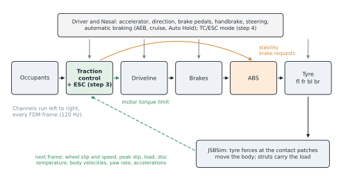
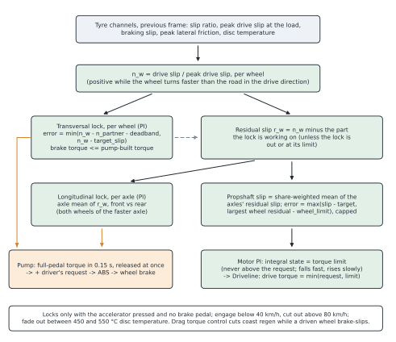
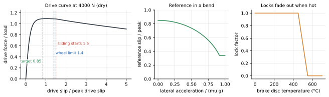
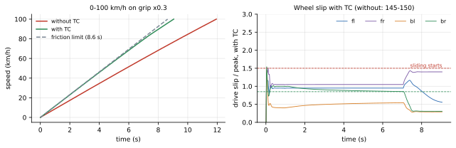
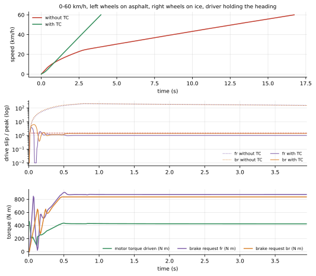

# Traction and stability control for the tyre model: engineering manual

Design, sources, parameters, verification and implementation plan for traction control (TC) and
electronic stability control (ESC) in the Follow Me EV's tyre and driveline model
(`followme_e-tron-tyre`). Read it together with `dev/tyre-model/README.md`, which describes the tyre
model, the brakes and ABS that this builds on.

Status is tracked in section 11. Parameter values are the current ones; section 12 lists them all.
The figures are drawn by `dev/tyre-model/manual_figures.py`, the plots from the generated FDM
running in standalone JSBSim. `dev/tyre-model/manual_pdf.py` prints this file to
`tc-esc-engineering-manual.pdf` with a headless Chrome. Run both again after a change.

## 1. Scope

- TC: keep the driven wheels near their best drive slip with the motor torque, and stop a single
  spinning wheel or axle with the brakes, so that the open differentials can pass torque on.
- Drag torque control (EDTC, also called MSR): stop coast regeneration from locking the wheels.
- ESC: compare the car's yaw rate and sideslip with what the driver asks for and correct them with
  individual wheel brakes and the motor torque.
- Driver controls and information: mode switch, warning lamps, sound.

Everything that decides forces runs inside the JSBSim system generated by
`dev/tyre-model/generate.py`, every FDM frame, like ABS. Nasal only handles the mode switch, the
lamps and the sound. The standard FDM (`followme_e-tron`) gets none of it: it has no wheel speeds.

## 2. Sources

| Id | Source | Used for |
|---|---|---|
| S1 | K. Reif (ed.), *Brakes, Brake Control and Driver Assistance Systems*, Bosch Professional Automotive Information, Springer Vieweg 2014, ISBN 978-3-658-03978-3. Chapters "Traction control system" and "Electronic stability program" | TC structure for a four-wheel-drive car with open differentials, controller types, reference slip, drag torque control, ESP hierarchy and reference yaw rate |
| S2 | Audi Service Training, Self Study Programme 994475AG, *Audi ESC systems* | EDL and TCS division of work, EDL temperature model, MSR, ESC interventions, button logic, lamps |
| S3 | Volkswagen Self-Study Programme 374, *Traction Control and Assist Systems* | EDL speed range, EDL cancelled by the brake pedal and by disc temperature, TCS above 80 km/h by torque only |
| S4 | ika (Institut für Kraftfahrwesen Aachen) for CITA, Report 8329, *A test procedure for vehicle dynamic controllers* | Measured data and controller models of a Mercedes-Benz A-Class and a BMW 330xi, fitted to driving tests: TCS thresholds, ESC thresholds, brake levels, build-up times, sideslip limitation |
| S5 | BMW Technical Training, *E46 Traction and Stability Control Systems* (archive.org) | Pump builds pressure for TC/ESC braking, DSC on at every start, short and long button press, MSR |
| S6 | Audi A4 (B5) workshop manual, ABS/ESP system description, pages "EDL" and "TCS" (workshop-manuals.com) | EDL engages up to 40 km/h and cuts out at 80 km/h on four-wheel drive, disc temperature model with upper and lower thresholds |
| S7 | Audi press release, *In search of driving pleasure: quattro drive and suspension of the Audi e-tron*, 15 Sept 2021 | ESC modes of an electric quattro, slip control in the power electronics at millisecond intervals, brake reaches full pressure in about 150 ms |
| S8 | FMVSS No. 126 (49 CFR 571.126) and its final rule, NHTSA, 2007; UN Regulation No. 140 is equivalent | Sine with dwell test, ESC on at every start, telltales. Public; to be added to `Docs/ESC/` in step 3 |
| S9 | NHTSA DOT HS 809 747 (in `Docs/ABS/`) | The ABS behaviour TC and ESC sit on top of |

S1 to S7 are copyrighted. Local copies in `Docs/ESC/` stay out of the repository (see `.gitignore`);
cite them by title. S8 and S9 are US government publications.

What the sources do not give: measured TC performance of a production car (how much faster on ice
with TC than without). TC is not regulated and none was found. TC is therefore verified against
physical limits and the behaviour the sources describe, not against a measured car. ESC has S8.

## 3. The vehicle as it stands

### 3.1 Driveline and brakes

One motor (460 N·m, 375 kW) through a single 9.73:1 reduction and an open centre differential with
a fixed split (`driveline/par/front_torque_share`, 0.5) to two open axle differentials. Each wheel
therefore gets a fixed share of the motor torque: a quarter at 50:50. This is the layout of S1's
figures 7 and 8 ("drive concept of a four-wheel-drive vehicle with TCS").


*Figure 1. The drivetrain seen from above, with the traction controllers of section 6 and what each
one acts on.*

Service brakes: 2300 N·m per front wheel and 836 N·m per rear wheel at full pedal, ABS on all four
wheels, rear axle select-low, front yaw moment build-up delay. See the tyre model README.

### 3.2 Handling

| | Value | Note |
|---|---|---|
| Mass with driver | 1635 kg, 52 % front | `mass.py` |
| Yaw inertia | 1830 kg·m², dynamic index 0.72 | S4 measured 0.66 (A-Class, 1200 kg·m²) and 0.85 (330xi, 2730 kg·m²) |
| Springs, track | 78.8 kN/m at every corner, 1.32 m front and rear, no anti-roll bars | roll stiffness 50:50 |
| Understeer gradient | 0.11 deg/g at 40 km/h rising to 0.30 at 120 km/h, 0.21 at 80 km/h | nearly neutral; steady turns up to 4 m/s² |
| Characteristic speed | 111 m/s at 40 km/h to 68 m/s at 120 km/h, 82 m/s at 80 km/h | ESC's reference uses the 80 km/h value (7.1) |

A prototype front anti-roll bar moved the understeer gradient only from 0.09 to 0.36 deg/g at 70 %
front roll stiffness: the KIT tyre's cornering stiffness is nearly proportional to load below 4 kN.
The chassis stays as it is; with 50:50 drive a slide can be caught by flooring the accelerator
(measured in 3.3).

### 3.3 Baseline without TC or ESC

Standalone JSBSim, 120 Hz, flat ground. "Slip/peak" is a wheel's drive slip over its tyre's peak
drive slip at its load.

| Case | Result |
|---|---|
| Dry, 50:50, full throttle | 0-100 km/h 3.64 s; front right wheel to 6.7 times its peak slip, front left 0.65 |
| Dry, 30:70 | 3.43 s, no wheel past its peak |
| Grip x0.3, 50:50 | 11.9 s, all wheels spinning near the motor speed limit; grip alone would allow about 8.6 s |
| Grip x0.3, 30:70 | spins round (120 deg) |
| Split grip, right side x0.3 | 0-60 km/h 5.6 s, right wheels to 140 times their peak slip |
| Split grip, right side x0.1 | 0-60 km/h 16.7 s: the spinning wheels drive the motor to its speed limit, which cuts the torque of all four |
| Sine with dwell (S8), 80 km/h, coasting, A = 19.7 deg of steering wheel, 1.5A to 270 deg both ways | 38 of 52 runs fail, 13 of them turn round (sideslip up to 89 deg) |
| Same at 6.5A, flooring it at 10 deg sideslip | 50:50 and front drive recover (sideslip at most 11-18 deg); 30:70 and rear drive spin harder |


*Figure 2. Sine with dwell at 6.5A without ESC. Coasting, the yaw rate does not come back after the
steering ends and the car turns round (sideslip near 90 deg); S8 asks for at most 35 % of the peak
yaw rate 1.0 s after the steering ends and 20 % after 1.75 s. Flooring the accelerator at 10 deg of
sideslip recovers it with 50:50 drive.*

## 4. Architecture

### 4.1 Channel order

```
Occupants -> Traction and stability control (new) -> Driveline -> Brakes -> ABS -> Tyre fl, fr, bl, br
```



*Figure 3. What the generated system computes in one FDM frame. Traction and stability control
read the previous frame's tyre and body state and set the motor torque limit and the stability brake
requests.*

The `Traction and stability control` channel holds TC and then ESC. Like ABS it works one frame
behind (8.3 ms at 120 Hz): it reads what the tyre channels computed in the previous frame and sets
this frame's motor torque limit and stability brake requests.

### 4.2 Hierarchy (S1)

ESC sits above TC and ABS. ESC works out what the car should do and changes the targets of the
lower controllers: TC's target slip, and brake requests that ABS then limits. TC and ABS execute.
Nothing below ABS can lock a wheel: every brake request, the driver's or a controller's, passes
through ABS.

### 4.3 Actuators

1. Motor torque limit `tc/motor_cap_nm`: the Driveline channel drives with the smaller of the
   driver's request (`driveline/request_torque_nm`) and this limit (`driveline/drive_torque_nm`).
   An electric motor sets its torque within milliseconds (S7), so the limit takes effect in the same
   frame. ESC multiplies the torque by its own factor (`esc/torque_factor`, 7.2).
2. Stability brake request `tyre/<w>/stab_brake_nm` per wheel, added to the driver's service brake
   request in front of ABS. It is built up by the pump at a limited rate and released quickly.
3. Pressure release `esc/keep_<w>`: the share of the driver's service brake request a wheel keeps,
   below 1 only while ESC lets pressure off (7.2).

### 4.4 Sensors

| Real car (S1) | This model |
|---|---|
| Wheel speeds, reference speed estimated from wheels and accelerometers | true speed of each contact patch, as ABS already does |
| Yaw rate, lateral and longitudinal acceleration | true values from JSBSim |
| Steering wheel angle | `fcs/steer-pos-deg` of the front wheels |
| Sideslip estimated by an observer | true body sideslip |
| Road friction estimated from accelerations | true peak friction of the tyres (`mu_x`, `mu_y`) |

Taking true values is a simplification (section 10).

## 5. Signals

Computed in the Traction control channel from the previous frame:

- Drive slip of a wheel over its peak drive slip: `n_w = slip_ratio * direction / drive_peak_slip`.
  It is positive while the wheel turns faster than the road in the drive direction, also in
  reverse and when rolling back on a slope.
- Braking slip over the peak braking slip: `b_w`, as ABS computes it.
- Propshaft slip, the torque-weighted mean of the driven wheels:
  `n_prop = s * (n_fl + n_fr) / 2 + (1 - s) * (n_bl + n_br) / 2`, with `s = front_torque_share`.
  It corresponds to the speed of the centre differential's input, the motor speed.
- Axle differences `n_fl - n_fr`, `n_bl - n_br`, and front minus rear axle mean.
- Effective friction `mu_eff`, the mean of the four tyres' peak friction, and lateral use
  `u_y = |a_y| / (mu_eff * g)`.

## 6. Traction control

S1 builds TCS for this layout from controllers that each regulate one variable: a propshaft speed
controller on the engine, a longitudinal differential lock controller and one transversal
differential lock controller per axle on the brakes. S2 and S3 describe the same split: EDL
(the brake) first when the two wheels of an axle slip differently, TCS (the torque) when both slip
alike. S4's model switches between the two at 38 km/h.



*Figure 4. Traction control signal flow. The locks brake the slip in which the wheels differ; what
they leave goes to the motor controller.*

### 6.1 Propshaft speed controller (motor torque)

- Controlled variable: `n_prop`, built from each wheel's residual slip: the slip its locks leave.
  While a wheel's transversal lock is available and not yet at its torque limit, the part of its
  slip the lock is working on (6.2) is taken off; the same for an axle and the longitudinal lock.
  So the brakes take the slip in which the wheels differ and the motor the slip they share, which is
  S2's order (EDL first when the two wheels slip differently, TCS when both slip alike). When the
  locks are out (above 80 km/h, discs hot, brake pedal, lock at its limit) the motor sees all of it.
- Single wheel limit: the error is also positive when any driven wheel's residual slip passes
  `wheel_limit` (1.4 of its peak; the tyre starts sliding at 1.5). Without it one wheel could spin
  above the locks' speed range while the mean stayed low. S4 likewise gives the faster wheel a wider
  band than the slower one.
- The error is capped at `error_limit` (2), so one wheel flaring at the start cannot cut the motor
  to nothing before its lock catches it.
- Reference: `n_ref = target_slip * max(corner_min, sqrt(1 - u_y^2))`. S1 lists the tyre's slip
  characteristic, the effective friction, the tractive resistance and the lateral acceleration,
  yaw rate and steering as inputs to the reference slip; S4's thresholds are about a third lower
  when cornering. The friction ellipse expresses the same: drive slip that leaves room for the
  lateral force. ESC adds an offset in step 3.
- Controller: PI acting on the motor torque limit (S1 calls it PID-like; the derivative is left out
  because slip at 120 Hz is noisy).
    - The integral state is the torque limit itself. It is never above the driver's request, so it
    does not wind up, and it starts from the current torque when it first acts.
    - It falls fast (`cut_rate`) when the slip is above the reference and rises more slowly
    (`restore_rate`) when below, as S4's reduce/hold/increase logic does.
    - A proportional part (`p_gain`) acts at once.
- TC is active while the limit is below the driver's request. It works at all speeds and in
  reverse (S6, S3).
- No symmetric braking support: S1 uses it only because an engine's torque responds slowly.



*Figure 5. Left: the fitted drive curve at 4000 N with the sliding blend of the tyre model, and where
TC's target, the single wheel limit and the onset of sliding lie; the curve is flat between them.
Middle: the reference slip as the lateral grip is used up in a bend. Right: the locks' fade with
brake disc temperature (6.5).*

### 6.2 Transversal differential lock controllers (brakes, one per axle)

- Controlled variable: `n_left - n_right` beyond a deadband (`lock_deadband`, 0.5 of the peak),
  and only the part above `target_slip`: error `min(n_w - n_partner - deadband, n_w - target_slip)`.
- The wheel that slips more is braked; each wheel has its own integral state, so the brake moves
  to the other side on its own when the difference changes sign. PI (S1: PI with nonlinear parts),
  in units of the wheel's largest drive torque.
- The integral state may not run ahead of what the pump can have built by the next frame. Without
  that limit it reached its maximum within three frames while the pump had built a third of it.
  The motor controller then took the lock for saturated and cut the motor to nothing.
- Braking a spinning wheel lets the open differential put the same torque, plus the brake torque,
  on the other wheel (S1, S2). In this model each wheel already gets its fixed share; the lock keeps
  the spinning wheel near its peak slip so that the motor does not reach its speed limit and the
  propshaft controller need not cut the torque of all four (section 10).
- Speed range (S6, S3): engages below `lock_engage_kmh` (40 km/h), stays engaged up to
  `lock_cutout_kmh` (80 km/h, four-wheel drive).
- Off while the driver presses the brake pedal (S3) and when the accelerator is released.
- Faded out by disc temperature (6.5).

### 6.3 Longitudinal differential lock controller (brakes, both wheels of one axle)

- Only with both axles driven (`0 < front_torque_share < 1`).
- Controlled variable: front axle mean minus rear axle mean beyond the deadband; the axle that
  slips more is braked on both wheels (S1).
- Same speed range, pedal and temperature rules as 6.2.

### 6.4 Brake path

- `stab_brake_nm` of a wheel is the sum of its lock outputs (and later ESC's), at most the wheel's
  full-pedal torque. A rear wheel's 836 N·m cannot hold a rear wheel on ice against its full drive
  torque (about 1100 N·m); the motor controller takes the rest once that lock is at its limit.
- Pump: the request rises at most at `pump_rate` (the full front brake torque in 0.15 s; S7 gives
  about 150 ms to full pressure, S4 0.05 to 0.15 s) and falls at once.
- The wheel's brake request into ABS becomes the driver's service request plus `stab_brake_nm`,
  limited to the full-pedal torque. ESC raises pressure beyond the driver's in the same way (S2).
- ABS on a wheel with a stability request: the rear axle leaves select-low and controls that wheel
  by itself, and the front yaw moment build-up delay does not hold it back. Both exist to keep
  unwanted yaw out of plain braking; a stability request is wanted yaw or wanted traction.

### 6.5 Brake disc temperature model

S2: the controller computes each disc's temperature from the length of the intervention, the
speed, the pressure and the material, and gradually switches EDL off at its limits. S6: it comes
back below a lower threshold.

- Per wheel: `m * c * dT/dt = brake_torque * |omega| - (h0 + h1 * |v|) * (T - T_ambient)`.
- The locks' output is multiplied by a factor that falls from 1 at `temp_fade_c` to 0 at
  `temp_off_c`, so they come back as the disc cools.
- The temperature counts all braking, the driver's too, but only gates the TC brakes; there is no
  brake fade model.
- The FDM restarts cold after a reposition, which matches S6's "parked for an hour" rule closely
  enough.

Disc masses, heat capacity and cooling are estimates (section 12).

### 6.6 Drag torque control (EDTC)

S1, S2: when engine braking makes the driven wheels slip, raise the drive torque. Here that is the
coast regeneration: while a driven wheel's braking slip exceeds `drag_slip` of its peak, the coast
regen torque is scaled down quickly (`drag_cut_rate`), and it recovers slowly (`drag_restore_rate`).
It never adds drive torque. ABS already removes coast regen while it works.

### 6.7 Modes in the FDM

`tc/par/enabled` switches the motor controller and the locks off for tests. The driver's modes
(section 8) arrive from a FlightGear property in step 4:

| Mode | Motor TC | Locks | ESC |
|---|---|---|---|
| ON | yes | yes | yes |
| SPORT | target slip raised (`sport_target`) below 68 km/h (S5: more slip allowed up to 42 mph) | yes | sideslip allowed to grow further, no torque cut for oversteer (S2: A6/A7 quattro) |
| OFF | no | below 40 km/h only (S7: low-speed slip control remains for starting off) | no |

## 7. Electronic stability control

S8 asks for brake torques adjusted at each wheel, a closed loop on yaw rate and sideslip against the
driver's steering, a means to modify the motor torque, and operation above 20 km/h going forwards,
also while ABS or TC work. The model does each of these; `dev/tyre-model/README.md` (Stability
control) lists the parameters and results.

### 7.1 Reference yaw rate

`yaw_ref = v * delta / (L * (1 + (v / v_char)^2))`, limited to `mu_eff * g / v` and lagged by
0.1 s (S4 delays the steering with an all-pass filter instead). `v_char` is this car's own, 82 m/s,
measured at 80 km/h by `characteristic_speed()` in `sim.py`; S4's 16.7 m/s would flag ordinary bends
as oversteer here. For the torque cut alone, understeer is also measured against a reference that may
reach 1.5 times `mu_eff * g / v`.

### 7.2 Controller

S4's thresholds and torque levels, made continuous and scaled by the road's friction as S1's
yaw-moment controller is (S4's fixed steps switch on and off at each threshold, and do not change
with the friction):

| Error (rad/s) | Action | Source |
|---|---|---|
| yaw rate above 0.05, over 20 km/h, forwards | nothing below | S4, S8 |
| oversteer 0.07 to 0.15 | outer front brake 0 to 2000 N·m; inner wheels keep down to 20 % of the driver's pressure | S4 (600 N·m at 0.098 to 2400 at 0.15); S2, S8 (pressure reduction) |
| understeer 0.07 to 0.10 | inner rear brake 0 to 600 N·m | S4 |
| either, 0.07 to 0.15 | motor torque down to a quarter of what TC allows; held 0.3 s after the error eases, back within 0.3 s | S4 (quarter; it holds 2 s) |
| sideslip over 10 deg | front wheel on the side the car slides towards, 300 to 600 N·m, replacing yaw control; yaw control's brakes then scaled by 0.6 until the steering is centred | S4 (it uses a rear wheel for one direction) |

All brake torques are multiplied by `min(1, mu_eff)`. Found while tuning:

- The pressure release was added because braking on split grip with nobody steering still turned
  the car 126 deg with brake additions alone; at 50 % release it still did, at 80 % it turns 27 deg.
- Raising the reference limit above `mu g / v` for oversteer or for the understeer brake fails the
  sine with dwell (13 to 36 of 52 runs): the inner rear brake adds rotation. Only the torque cut uses
  the wider understeer reference.
- S4's 2 s torque hold made split-grip starts with nobody steering slow (10.3 s to 60 km/h); with the
  0.3 s hold they take 5.3 s but turn 25 deg instead of 10 deg.

### 7.3 Interaction

- Driver braking: ESC adds pressure on one wheel and lets it off the yaw-adding wheels, all through
  ABS; ABS leaves select-low for a rear wheel with a stability request.
- TC: ESC's torque share multiplies TC's limit; lock and ESC brake requests add up on a wheel.
- Throttle: ON cuts the torque in oversteer as S4's BMW does, four-wheel drive or not; SPORT will not
  (step 4).
- Handbrake lever: it locks the rear wheels past the hydraulics; ESC cannot stop the swing (80 deg
  of sideslip instead of 89).

## 8. Driver controls, lamps and sound (step 4)

- `/controls/esc/mode`: 0 ON, 1 SPORT, 2 OFF. Outside the FDM so that a reposition keeps it.
  Back to ON at every motor start (S2, S5, S8).
- Button: a short press toggles ON and SPORT; holding it for 3 s selects OFF; another press returns
  to ON (S2's R8 logic; S5 uses 2.5 s). A key, and an entry in the vehicle dialog.
- Lamps (S2): the dashboard already has `escoff_sign`, lit in SPORT and OFF. A new amber
  `esc_sign` (the skidding car without "OFF") flashes while TC or ESC intervenes. Both light during
  the ignition self-test.
- Sound: the hydraulic unit's pump (`Sounds/abs.wav`) also runs while stability brakes build
  pressure (S5).
- With the standard FDM the switch and the OFF lamp work but nothing intervenes.


*Figure 6. The driver's modes and the button (planned for step 4).*

## 9. Verification

Standalone JSBSim tests in `dev/tyre-model/test_tyre_model.py`. Tests of the tyre physics itself
run with TC and ESC off, as the ABS-off tests do now.

### 9.1 Traction control

| Test | Pass | Result (120 Hz) |
|---|---|---|
| Dry launch, 50:50 | no slower than without TC; no wheel past 1.5 times its peak slip after 0.5 s | 0-100 km/h 3.53 s (3.64 s without), slip at most 1.45 (6.7) |
| Grip x0.3 launch | much faster than without TC, within 15 % of the friction limit | 9.07 s (11.9 s without, 8.6 s limit), slip at most 1.48 (150) |
| Split grip, right wheels on ice, driver holding the heading | under 0.4 of the time without TC; ice wheels near their peak; only they are braked | 0-60 km/h 4.05 s (16.7 s), slip at most 1.4, heading within 2.2° |
| Grip x0.3, 30:70 and rear drive | no spin | 30:70: 0-60 km/h 5.3 s, heading within 2.2° (spins round without TC); rear drive 11.2 s, within 11° |
| Full throttle in a 40 km/h bend, rear drive | sideslip under 10° | 4.6° (over 45° without TC) |
| Reverse on grip x0.3 | faster than without TC, slip below 1.5 | 0-20 km/h 1.76 s (2.32 s) |
| Moderate throttle on dry, steady bend | TC never acts | never |
| Locks | not above 40 km/h, off above 80 km/h, off at once with the brake pedal, out with 600 °C discs | as required |
| EDTC | 300 N·m coast regen on grip x0.1 does not lock the driven wheels | braking slip at most 1.09 of the peak (7.4 without) |
| FDM rate 60 and 240 Hz | same results within 8 % | within 3.5 % |



*Figure 7. Full throttle on grip x0.3. With TC the car follows the friction limit closely. The front
right wheel, the lightest with the driver on the left, is held by its lock at the front left
wheel's slip plus the deadband, and above 80 km/h by the single wheel limit.*



*Figure 8. Full throttle with the right wheels on ice and a driver holding the heading. Without TC
the ice wheels spin up to about 200 times their peak slip and the motor reaches its speed limit. With
TC the pump builds the lock torque within 0.15 s. The front lock overshoots once and the rear lock
reaches its 836 N·m limit, so the motor controller takes the torque down briefly and gives it back
within about 0.7 s.*

Left alone on split grip the car turns about 32° by 60 km/h: the asphalt side drives, the ice side
is braked. With ESC it turns 25° (7.2).

### 9.2 ESC

| Test | Pass | Result (120 Hz) |
|---|---|---|
| Sine with dwell (S8), 80 km/h coasting, A = 19.7 deg, 1.5A to 270 deg both directions, 52 runs | yaw rate at most 35 % of the peak after 1.0 s and 20 % after 1.75 s; lateral move at least 1.83 m after 1.07 s from 5A; a run without a second yaw peak (spun) fails | all pass (38 fail without ESC, 13 spin); sideslip at most 8.8 deg; lateral move at least 3.05 m |
| Steady bends up to 4 m/s² (S1 linear range), 2A sine with dwell, straight starts and stops | ESC never acts | never; nor in steady bends up to 8 m/s² |
| Far too much steering, dry, 90 km/h | slower, tighter path | 68 km/h, 40 m (88 km/h, 73 m) |
| Rear drive, TC off, full throttle in a 40 km/h bend | sideslip under 15 deg | 13 deg (over 45 without) |
| Split grip braking, nobody steering / driver holding the heading | under 45 deg / at most 3 % longer stop | 27 deg (126) / 47.1 m (47.7) |
| Split grip full throttle, nobody steering | less pull, not much slower | 25 deg in 5.3 s (32 deg in 4.2 s) |
| Below 20 km/h and in reverse | never acts | never |
| Characteristic speed | parameter within 10 % of the measured one | 82 against 85 m/s |
| FDM rate 60 and 240 Hz | sine with dwell criteria hold, lateral move within 8 % | as required |

### 9.3 FlightGear

FlightGear 2024.1.8: mode button and dialog, lamps including the self-test, pump sound, a
reposition while TC is working, and a drive with each mode.

## 10. Simplifications and known differences

- Sensors are true values (4.4). Real controllers estimate speed, sideslip and friction and are
  less precise.
- The tyre model's peak slip does not change with the surface, only the friction does. A real
  tyre's best slip changes with the road, which a real TC must find out.
- The motor rotor's inertia is shared out to the four wheels. An open differential with a real,
  shared rotor holds the wheel with grip back while the other spins up (S1, S3); here that happens
  only once the motor reaches its speed limit. The locks' benefit therefore shows up as keeping
  the motor below that limit. A shared rotor inertia would make this exact (step 5).
- Brake temperature gates the TC brakes only; braking itself does not fade.
- ESC thresholds start from another car's (S4) and are tuned on this one.

## 11. Implementation plan and status

| Step | Content | Files | Status |
|---|---|---|---|
| 1 | Signals (5), propshaft speed controller (6.1), EDTC (6.6), `tc/par` parameters; Driveline splits the driver's request (`request_torque_nm`) from the torque driven (`drive_torque_nm`, which `Nasal/engine.nas` reads for the battery) | `generate.py`, `Systems/tyre-model.xml`, `sim.py`, tests, `report.py`, README | done, tested in standalone JSBSim |
| 2 | Lock controllers (6.2, 6.3), brake path and pump (6.4), disc temperature (6.5), ABS changes | same | done, tested in standalone JSBSim |
| 3 | `v_char` measurement, ESC (7), FMVSS 126 manoeuvres in `sim.py`, 9 tests | `generate.py`, `sim.py`, tests, `report.py`, README | done, tested in standalone JSBSim; figures, PDF and the FlightGear check not redone |
| 4 | Mode property, button, dialog, lamps, sound, FlightGear checks (8, 9.3) | `Nasal/`, `gui/`, `Models/Interior/Instruments/Smart/dashboard.svg`, `Sounds/followme-sound.xml`, `-set.xml` | planned |
| 5 | Optional: front/rear split review, friction estimate from accelerations, shared rotor inertia, wheel-selective torque control (S2's electronic transverse lock) | | open |

Each step ends with the generator, the tests and the README in step, and is one commit.

## 12. Parameters

Under `/fdm/jsbsim/tc/par/` (and `esc/par/` from step 3); the brake disc data are brake
properties and sit with the other brake parameters under `driveline/par/`. Values as tested.

| Parameter | Value | Meaning | Source |
|---|---|---|---|
| `tc/par/enabled` | 1 | 0 switches TC (motor controller, locks, EDTC) off | |
| `tc/par/target_slip` | 0.85 | reference drive slip as a share of the tyre's peak slip | S1, S4 (below the peak) |
| `tc/par/corner_min` | 0.4 | smallest share of the target left at full lateral use | S4 (cornering thresholds about a third lower) |
| `tc/par/wheel_limit` | 1.4 | no driven wheel the locks leave alone may pass this share of its peak | tyre model: sliding starts at 1.5; S4 |
| `tc/par/p_gain` | 0.3 | proportional part, share of the motor's maximum torque per unit slip error | tuned |
| `tc/par/cut_rate` | 10 | integral rate while slipping too much, per second per unit error | tuned; S4 (reduce) |
| `tc/par/restore_rate` | 5 | integral rate while slipping too little (8 lets a wheel on ice pass 1.5) | tuned; S4 (increase) |
| `tc/par/error_limit` | 2 | the motor controller acts on at most this error | tuned |
| `tc/par/lock_deadband` | 0.5 | slip difference (share of peak) the locks leave alone | tuned; S4 (select-high thresholds) |
| `tc/par/lock_p_gain`, `lock_rate` | 0.2, 8 | lock PI gains, in units of the wheel's largest drive torque | tuned; S1 (PI) |
| `tc/par/lock_engage_kmh` | 40 | locks engage below this | S6, S4 (38 km/h) |
| `tc/par/lock_cutout_kmh` | 80 | engaged locks cut out above this | S6, S3 |
| `tc/par/pump_time_s` | 0.15 | time for the pump to build a wheel's full-pedal brake torque | S7, S4 |
| `tc/par/temp_fade_c`, `temp_off_c` | 450, 550 | locks fade out between these disc temperatures | estimate (S2, S6 give no values) |
| `tc/par/drag_slip` | 1.0 | braking slip (share of peak) at which EDTC cuts coast regen | |
| `tc/par/drag_cut_rate`, `drag_restore_rate` | 20, 2 | per second | |
| `driveline/par/disc_kg_front`, `disc_kg_rear` | 9, 7 | disc mass | estimate |
| `driveline/par/disc_heat_j_kgk` | 460 | heat capacity of grey cast iron | |
| `driveline/par/disc_cooling_w_k`, `disc_cooling_w_k_per_mps` | 20, 2 | cooling at rest and per m/s | estimate |
| `driveline/par/ambient_c` | 20 | air temperature the discs cool to | |
| `sport_target` | step 4 | target slip in SPORT | S5 |
| `esc/par/*` | see `Systems/tyre-model.xml` | each listed with its meaning and source in `generate.py` (ESC_PARAMS) | S4, S8 |
